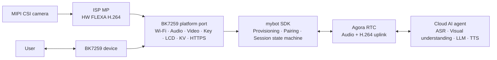

# mybot-bk7259

[](LICENSE)
[](https://github.com/junlon2006/mybot)
[](https://github.com/bekencorp/bk_avdk_smp)

**[简体中文](README.zh-CN.md) | English**

**mybot-bk7259** is the BK7259 reference implementation of the open-source
[mybot](https://github.com/junlon2006/mybot) AI multimodal conversation SDK. This repository organizes
the official BK7259 AP/CP SDK and AI solution as pinned Git submodules. Product sources and the
BK7259 platform port live in this parent repository, with reviewed vendor patches applied in
isolated build copies. It is intended to provide reproducible builds, a practical
platform development baseline, and a shared foundation for community collaboration.

> This project is an actively developed BK7259 reference implementation. Before using it in a
> production product, complete the board-level adaptation, security review, and stability
> validation for the target hardware, and verify the licensing and commercial-use terms of all
> third-party components.

## Relationship to upstream mybot

[mybot](https://github.com/junlon2006/mybot) is a cross-platform AI multimodal conversation SDK for
edge devices. Its core is written in C99, uses AOSL as its portable runtime, and obtains device
capabilities such as Wi-Fi, persistent storage, buttons, displays, audio, encoded video, and network
transport through platform `ops` interfaces.

This repository does not redefine the mybot SDK. It provides the complete implementation required
to run mybot on the BK7259 platform:

- BK7259 AP/CP dual-core startup, memory layout, and Flash partition configuration.
- Wi-Fi APSTA provisioning with a captive portal, network reconnection, and credential persistence.
- Three analog microphone inputs with appended digital-reference AEC, speaker playback, volume control, and audio power
  management.
- Optional MIPI CSI camera capture, ISP MP scaling, hardware FLEXA H.264 encoding, and encoded video uplink.
- Single GPIO conversation/factory-reset key, MIPI display, EasyFlash KV, HTTPS, and device identity
  adapters.
- Full-duplex audio and optional uplink video for AI multimodal sessions over Agora RTSA.
- Embedded Chinese and English OGG assets for provisioning prompts and pairing-code announcements.
- A complete flash image and an OTA package containing both the CP and AP firmware.

The device service, Agora RTC cloud service, and cloud AI agent are not part of this repository. A
device service compatible with the mybot protocol is required to run the complete workflow.

## System architecture



The BK7259 firmware uses an AP/CP dual-core architecture:

- **CP** performs base system initialization and SMP startup control.
- **AP** initializes the media service and runs the product control loop. It hosts the platform
  adapters, device lifecycle, networking, audio, video capture and encoding, display, and RTC
  session.
- **Control loop** ([ap_main.c](projects/mybot/ap/ap_main.c)) selects APSTA
  provisioning or normal STA mode according to the saved Wi-Fi credentials. After preparing the
  product-owned key, display, and network manager, it checks for an interrupted factory reset
  before registering the platform or starting the network and SDK. Once the network is up it
  starts the mybot SDK and handles conversation and factory-reset requests.

## Repository layout

| Path | Responsibility | Source |
| --- | --- | --- |
| `bk_avdk_smp/` | BK7259 AP/CP SDK and platform foundation components | Official `bekencorp/bk_avdk_smp`, commit `584b94792` |
| `bk_solution_ai/` | BK AI solution components | Official `bekencorp/bk_solution_ai`, commit `03aadb497` |
| `projects/mybot/` | AP/CP entry points, R2 board configuration, partition table, and prompt assets | Parent repository |
| `components/mybot/` | mybot SDK, BK7259 port, AOSL, and RTSA | Parent repository |
| `patches/`, `vendor.lock.json` | Reviewed vendor changes, fixed revisions, and patch hashes | Parent repository |
| `scripts/` | Dependency preparation, source checks, and isolated bilingual builds | Parent repository |

The `release/v4.0.1-mybot-r2` branch targets the Yunqu V1.0 R2 board. Its product sources and
necessary DNS, GC9503CV LCD, three-input AEC, and camera-helper patches are maintained here;
neither personal BK fork is required. The two official submodules remain clean at their exact
gitlink revisions. Builds validate `vendor.lock.json`, copy the official baselines into a generated
workspace, and apply the recorded patches there. This migration preserves the existing R2 behavior
and algorithm library; it does not upgrade the vendor SDK. See
[official dependency management](docs/OFFICIAL_DEPENDENCIES.md) for full pins, patch provenance,
preparation rules, and validation boundaries.

`components/mybot` is a component container holding three directories:

- `mybot_sdk` — the vendored mybot SDK source and the BK7259 platform operations (compiled as the
  `mybot_sdk` component).
- `mybot_aosl` — the vendored AOSL component (`mybot_aosl`).
- `mybot_rtsa` — the vendored Agora RTSA SDK (`include/` headers and
  `lib/arm/libagora-rtc-sdk.a`).

The product vendors the latest committed mybot SDK snapshot from upstream `main`
at `39d5ed122aab51d90c1c531298c4ead8dc35b104` (PR #115; SDK version remains 1.2.0).
MCP control over RTM P2P and channel messages requires one `message.user` envelope with
`data_type: "message"` and string `content` containing DeviceCommand v1. Supported actions are
`audio.set_volume` (`params.level`: integer 0–100) and `audio.adjust_volume` (`params.delta`: integer
-100–100). Positive deltas increase volume, negative deltas decrease it, and zero leaves it
unchanged; the result is clamped to 0–100. Bare commands, `audio.set_mute` and emotion commands
are not executed over RTM. Execution checks the active sender,
channel, conversation, and conversation generation. `issued_at` and `expires_at` may be omitted or
provided but are ignored; there is no expiry or clock check. Each session deduplicates the most
recent 16 distinct `command_id` values in FIFO order. Duplicates do not refresh their position
or repeat a relative volume adjustment; new IDs evict the oldest, so an evicted ID may execute again.
The existing voiceprint and server-phase flow is retained, as are nonblocking control-event delivery,
re-pairing cancellation, prompt-generation tracking, and HTTP/JSON boundary fixes.
It also includes serialized video control, deferred prompt teardown,
unified RTM-to-LCD indicators, and the
`RTC_LOG_ERROR` and AOSL log-gate preservation; the remaining BK7259 target patch records debug
HTTPS request and response body logging in `SDK_REVISION`.
Conversation hangup now stops local video/RTC, clears session PCM, and publishes READY before
queuing one HTTP(S) stop notification. Binding-status polls and stop notifications run on a separate
`service_mpq`, so slow responses do not block control handling or the next conversation trigger.
Notification failure is logged without retry. Conversation start, pairing-code and token-renewal
requests remain synchronous; SDK shutdown drains the background worker before releasing resources.
The HTTPS adapter supports independent connections and reads socket errors per connection.
It includes the RTM server-state LCD
indicators and the optional video uplink contract. Video is enabled by default in the BK7259 AP build.
`SDK_REVISION` records the selected commit, target patch, and deterministic `include/` and `src/` digest. AOSL is based on commit
`84e086084ebcd0ae2455a0ce5721950c5fe2e656` with its five documented BK7259 HAL fixes. The build has
no `MYBOT_SDK_DIR` or external AOSL source-path input.

The SDK removes the 512-byte RTM text preview and fixed 64-byte RTC error storage, passing full
content to the logging layer and copying borrowed RTC error text while it is valid. The BK7259
AOSL HAL still has an 8 KiB buffer for the entire log line, so larger lines may be truncated.
Ordinary RTM message logs remain DEBUG and are omitted at the default NOTICE level.

MCP volume set/adjust uses the existing BK7259 volume adapter; the command path still needs
hardware validation. The BK7259 view retains local expressions and indicator bits 0-3
(voiceprint and server phases). Cloud MCP emotion input is disabled in this SDK snapshot.
Local LCD expressions do not trigger EB521 UART/gimbal movement. Manual CLI gimbal control is available only with
`CONFIG_MYBOT_GIMBAL=y`; the current audio comparison build disables that option.

## Requirements

- Git with Git submodule support.
- A Linux build environment and the cross-compilation toolchain required by `bk_avdk_smp`.
- A BK7259 Yunqu V1.0 R2 board, or compatible hardware using the same peripheral
  connections.
- Access to a compatible mybot device service and valid Agora service configuration.

Board-level documentation ships inside the submodules: `bk_solution_ai/docs/bk7259/` for the
solution and the AVDK, and `bk_avdk_smp` for the SDK and flashing tools.

## Get the source

Clone the repository and its submodules over HTTPS:

```bash
git clone --branch release/v4.0.1-mybot-r2 --recurse-submodules https://github.com/junlon2006/mybot-bk7259.git
cd mybot-bk7259
```

If the top-level repository has already been cloned without its submodules, run:

```bash
git submodule sync --recursive
git submodule update --init --recursive
```

After cloning, inspect the pinned revisions with:

```bash
git submodule status
```

When the GitHub downloads are slow, keep the canonical URLs in `.gitmodules` and use existing
local repositories only as command-scoped mirrors:

```bash
git -c protocol.file.allow=always \
    -c 'url.file:///path/to/bk_avdk_smp.insteadOf=https://github.com/bekencorp/bk_avdk_smp.git' \
    -c 'url.file:///path/to/bk_solution_ai.insteadOf=https://github.com/bekencorp/bk_solution_ai.git' \
    submodule update --init
```

This does not persist local paths or change the published submodule URLs.

## Build the firmware

Run the managed build from the repository root. It verifies the official pins and patch hashes,
prepares patched vendor copies, and builds separate Chinese and English AP/CP projects:

```bash
python3 scripts/check_sources.py
python3 scripts/build_all.py
```

`scripts/build_all.py` supports separate Chinese and English AP/CP builds with
`releases/bk7259-zh-CN-video.bin` and `releases/bk7259-en-US-video.bin` filenames by default.
When `CONFIG_MYBOT_VIDEO` is disabled, the filenames omit the `-video` suffix.
The script uses the selected device-service protocol for both languages and checks the generated
configuration and ELF endpoint. HTTP builds add `-http` to the image name, for example
`releases/bk7259-zh-CN-video-http.bin`; with video disabled, the name is `bk7259-zh-CN-http.bin`.
Build both languages with `python3 scripts/build_all.py`, or select one with
`python3 scripts/build_all.py --language zh-CN` / `--language en-US`.
`--dry-run`, `--no-clean`, `--build-root`, and `--output-root` are also supported.
The script keeps the source project configuration and official submodules intact;
images are published only after all requested variants succeed.

Only `MYBOT_AUDIO_PTIME_MS=60` is supported. Other values are rejected.
To invoke vendor `make` directly, first prepare the selected language:

```bash
python3 scripts/prepare_vendor.py --language zh-CN
```

Run the complete `make` command printed by that tool; it names the generated project and its
matching explicit `SDK_DIR`. Do not build the source project against the unpatched official SDK.
The preparation script does not fetch, reset, or edit the official checkouts. See the
[dependency guide](docs/OFFICIAL_DEPENDENCIES.md) for cache and upgrade rules.

For the default Chinese video build, outputs are under
`build/build-bk7259-zh-CN-video/solution/projects/mybot/build/bk7259/mybot/package/`:

| File | Purpose |
| --- | --- |
| `all-app.bin` | Complete flash image containing the bootloader, CP, and AP firmware |
| `app_pack.rbl` | OTA package containing both the CP and AP firmware |
| `build_summary.txt` | Flash, SRAM, IRAM, DTCM, and PSRAM usage report |

The individual CP and AP images are written to:

- `<generated-project>/build/bk7259/mybot/bk7259/app.bin`
- `<generated-project>/build/bk7259/mybot/bk7259_ap/app.bin`

The English variant uses `build/build-bk7259-en-US-video/`; `--build-root` and `--output-root`
can keep test builds and firmware separate from existing outputs.

## Flash and run

Use the Beken flashing tool to write `all-app.bin` to the device, following the instructions for
the target development board and the Beken flashing documentation shipped in `bk_avdk_smp`.

The reference device workflow is:

1. On first boot, or when no valid Wi-Fi credentials exist, the device enters APSTA provisioning
   mode and creates an open `mybot-xxxx` SoftAP.
2. Connect to the SoftAP and open `http://192.168.4.1/`, then select the target network and submit
   its credentials. The configuration page also opens on its own, without the address being typed
   — see [Wi-Fi provisioning](#wi-fi-provisioning).
3. After the STA link obtains an IPv4 address, the portal and SoftAP stop and the device starts the
   mybot SDK for registration, pairing, and authentication.
4. An unclaimed device displays and announces its pairing code for entry in the web console. After
   the device is claimed, briefly press and release the conversation button to start an AI
   conversation with full-duplex audio; camera video uplink is included when `CONFIG_MYBOT_VIDEO=y`.
   Press and release again to stop it.
5. Hold the same button for five seconds to reset the local device settings and restart Wi-Fi setup.

The Yunqu V1.0 product exposes one firmware-visible direct GPIO conversation key:

| Button | GPIO | Active level | Short press | Long press |
| --- | --- | --- | --- | --- |
| Conversation | GPIO47 (`KEY1`) | Low | Release to start or stop a conversation | Hold 5 seconds to factory reset |

GPIO assignments and display, audio, and camera peripheral connections are board-level
configuration.
Porting to different BK7259 hardware requires corresponding configuration and platform changes.

## Configuration

The primary project configuration files are:

- AP: `projects/mybot/ap/config/bk7259_ap/defconfig`
- CP: `projects/mybot/cp/config/bk7259/defconfig`
- Flash partitions: `projects/mybot/partitions/bk7259/auto_partitions.csv`
- SRAM/PSRAM layout: `projects/mybot/partitions/bk7259/ram_regions.csv`

The `MyBot BK7259 platform` Kconfig menu provides:

- `CONFIG_MYBOT_LANGUAGE_ZH_CN`: Chinese service region, LCD text, and prompt assets.
- `CONFIG_MYBOT_LANGUAGE_EN_US`: English service region, LCD text, and prompt assets.
- `CONFIG_MYBOT_HTTPS`: device-service REST transport; enabled by default for HTTPS. Use
  `# CONFIG_MYBOT_HTTPS is not set` in the AP defconfig to select HTTP, then clean and rebuild
  with the commands above. Restore `CONFIG_MYBOT_HTTPS=y` and clean rebuild to select HTTPS again.
- `CONFIG_MYBOT_LVGL_UI_ANIMATIONS`: pixel-face transitions, expression motion, and the 500 ms terminal cursor,
  enabled by default. The UI uses the fixed process-gray appearance.
- `CONFIG_MYBOT_VIDEO`: encoded H.264 video uplink; enabled by default. Use
  `# CONFIG_MYBOT_VIDEO is not set` to disable video, then run a clean rebuild.
- `CONFIG_MYBOT_VIDEO_WIDTH` / `CONFIG_MYBOT_VIDEO_HEIGHT`: `640x480` encoded output.
- `CONFIG_MYBOT_VIDEO_SENSOR_WIDTH` / `CONFIG_MYBOT_VIDEO_SENSOR_HEIGHT` /
  `CONFIG_MYBOT_VIDEO_SENSOR_FPS`: `1280x720` sensor input at `5` fps.
- `CONFIG_MYBOT_VIDEO_MIN_BPS` / `CONFIG_MYBOT_VIDEO_MAX_BPS`: encoder and RTSA bandwidth range,
  currently `256000` to `512000` bits per second.
- `CONFIG_MYBOT_KEY_GPIO` and `CONFIG_MYBOT_KEY_ACTIVE_LEVEL`: the single conversation-key GPIO
  and electrical active level.

The language option selects the LCD text, service region, and prompt asset directory: Chinese
(`https://botstation.shengwang.cn/api`) or English (`https://botstation.agora.io/api`) with
the default HTTPS configuration. Exactly one of the two language options must be enabled.
HTTP mode changes only the scheme to `http://`, retaining the hostname and `/api` path.
The transport switch maps to the SDK's `MYBOT_ENABLE_HTTPS` and inverse
`MYBOT_ALLOW_INSECURE_HTTP` compile definitions; it does not change RTC/RTM or the local
HTTP provisioning portal.

This R2 migration retains the previous two-root PEM trust store (ISRG Root X1 and DigiCert
Global Root G2), rather than importing `main`'s regional single-root change. A server chain
requiring GoDaddy G2 is not covered by this store; the overseas endpoint therefore needs separate
certificate-chain validation before deployment. Certificate and hostname verification remain enabled.

Everything else about the device identity is fixed by the port rather than configured:
[ap_main.c](projects/mybot/ap/ap_main.c) derives the device id at runtime from the
per-chip device UID (read by the CP) using HMAC-SHA256 with `mybot-bk7259-device-id-v1` as the
derivation key. The first 12 digest bytes are uppercase hex, formatted as
`BK7259-<24 uppercase hex characters>`. It reports
the SDK's own `MYBOT_VERSION_STRING` as the firmware version and `mybot-bk7259` as the hardware
model, and prints both at startup. A device whose UID cannot be read has no identity, so it
logs the failure and does not start. Do not commit production service credentials.

## Keys

The single conversation key is scanned on GPIO47 (`KEY1`) as an active-low input every 20 ms with
two-sample debounce. A short press posts a request on release. The product control loop queries
`mybot_get_state()`: `READY` dispatches the conversation-start event and `IN_CONVERSATION`
dispatches the conversation-stop event. Other SDK states ignore short presses. Double-press,
volume, and reserved-key actions are not registered.

Holding the key for five seconds posts one factory-reset request and suppresses the short action
on release. A key already held when the platform prepares must be released before a new gesture
can start, preventing a reset loop across reboot. Long press is available after successful
platform preparation, including Wi-Fi provisioning and periods before the SDK attaches its key
callback. Five seconds is the gesture threshold; completing reset also requires SDK and network
shutdown.

[usr_gpio_cfg.h](projects/mybot/ap/config/bk7259_ap/usr_gpio_cfg.h) sets GPIO47
(`KEY1`) as an input with an internal pull-up. The CEN button remains hardware reset only.

## Factory reset

The product task owns reset execution; the key timer only posts requests. It displays the reset
status and persists `mybot.factory_reset.v1` before stopping the SDK. Cleanup starts only after
the SDK reaches `STOPPED` and the portal, SoftAP, scan, and STA teardown succeed, so configuration
writers cannot recreate deleted records.

| Record | Reset action |
| --- | --- |
| `mybot.device_auth` | Delete local device authentication |
| `mybot.wifi.v1` | Delete saved Wi-Fi credentials |
| `mybot.volume.v1` | Delete saved volume; subsequent startup uses the speaker default |
| `mybot.factory_reset.v1` | Delete the reset marker last, after verifying the three records are absent |

Successful cleanup displays the reboot phase, then restarts into the normal first-boot network
setup flow. Reset removes only these product records. The UID-derived device ID remains unchanged,
and reset does not send a server-side unbind request.

If persistence, SDK/network shutdown, or deletion fails, the device displays a failure and waits
for a fresh five-second press to retry. Incomplete cleanup keeps the persisted marker, or attempts
to restore it if the final marker deletion fails. Boot checks a valid marker before network/SDK
startup and resumes cleanup. If marker lookup reports invalid or unreadable data, the failure page
requires a fresh long press. The marker is persisted when the product task processes the request,
so power loss before that point does not establish a pending reset. Storage fault-detection limits are recorded in
[UI_VALIDATION.md](projects/mybot/UI_VALIDATION.md).

The independent [bk7259_key.h](components/mybot/mybot_sdk/platforms/bk7259/include/bk7259_key.h)
and [bk7259_factory_reset.h](components/mybot/mybot_sdk/platforms/bk7259/include/bk7259_factory_reset.h)
declare `bk7259_*` product requests and reset helpers. The platform registration abstraction remains
in `mybot_bk7259_platform.h`.

## Startup

The CP initializes the BK runtime and starts the AP. The AP startup sequence is:

1. Initialize the BK runtime and media service, then create the `mybot_app` product task.
2. Build the server/firmware/hardware configuration and derive the device ID from the chip UID.
3. Initialize AOSL and prepare the product-owned LCD, Wi-Fi manager, and GPIO key, in that order.
4. Check for a pending factory reset before platform registration or network/SDK startup. A valid
   marker resumes reset; a reported marker error waits for a fresh five-second hold.
5. Register the complete platform descriptor and connect saved Wi-Fi, or finish APSTA provisioning.
6. Start the SDK after STA obtains IPv4; it handles registration, authentication, and pairing
   according to the server's binding state.
7. Poll the SDK lifecycle and handle short conversation requests and long factory-reset requests.

Network/SDK startup failures and runtime exit retain the prepared key and display while waiting
for factory reset. Earlier identity, media-service, platform-preparation, or descriptor-registration failures
can exit startup; the reset recovery path is not guaranteed for those failures. A key held while
the platform prepares must be released before a new gesture.

## Display

The product owns one GC9503CV MIPI display from platform preparation through platform shutdown, so
Wi-Fi provisioning and reset status remain visible while the mybot SDK is stopped. The native
480x640 panel is rendered as a 640x480 logical RGB565 surface. GPIO20 enables the 3.3 V rail,
GPIO29 enables the shared LCD/camera 2.8 V rail, GPIO42 drives reset, and the GPIO40 backlight is
active low. GPIO27 enables the external camera 1.2 V rail at a high level during platform
preparation. The LCD board-power owner keeps both rails on until full platform shutdown;
conversation/video teardown resets the camera through GPIO30 without cutting board power.

The LVGL 9.5.0 renderer follows the user-supplied simulator's `process` (process gray) skin and
`geek` (pixel glasses) face. It uses a fixed `#050708` black glass background and gray decorations,
avoiding visible dark-gradient banding in RGB565.
`READY` shows the neutral idle face: off-white `#f1f1ee` glasses, two curved eyes, and a smile.
Entering `IN_CONVERSATION` shows SURPRISED for 300 ms after its entering transition,
then selects the latest server phase: LISTENING shows the listening face; THINKING
shows the thinking face and changes to PROCESSING after three continuous seconds;
SPEAKING or no active phase shows NEUTRAL. Hangup returns to neutral idle.
Wi-Fi setup alone does not bypass authentication or pairing: the
ordinary idle page appears only when the SDK actually reaches `READY`.

Normal idle and conversation screens retain four terminal rows. In READY:

```text
> OIM / R2
> mood: neutral
> state: ready
> agora / realtime
```

The mood follows the selected expression in lowercase, independently of the actual SDK state.
The third row reports that state; during a conversation it shows, for example,
`> state: listening | vp:pending`, with `thinking` or `speaking` as reported by the SDK.
If multiple phase indicators are active, priority is `speaking` > `thinking` > `listening`.
When no phase is active, it falls back to `in_conversation`. `vp:ok` means the current session
has received a successful voiceprint notification; `vp:pending` means it has not yet been confirmed.
These session fields appear only when the runtime state and display page are both
`IN_CONVERSATION`; selecting the SLEEP artwork does not replace the actual state with `standby`.
The `</>` signature and last-row cursor remain. Voiceprint updates affect text; phase updates
also select the underlying automatic face. Repeated updates do not restart its animation or
the three-second thinking clock, and do not cancel an explicit expression. No separate status
overlay is shown.
Chinese and English startup, provisioning, web-console pairing, error, and
factory-reset instructions remain available. GPU and touch stay disabled, and the display does
not show a camera preview or control gimbal movement.

All 23 simulator expressions are available through the independent
[bk7259_expression.h](components/mybot/mybot_sdk/platforms/bk7259/include/bk7259_expression.h)
module. `bk7259_lcd_set_expression()` copies a persistent local override to the display owner;
`bk7259_lcd_clear_expression()` restores the latest automatic face. Overrides are accepted only
on `READY`/`IN_CONVERSATION` pages; workflow changes clear them, and factory-reset and operating
guidance retain priority. Repeating a local request does not restart it.

Cloud MCP emotion input is disabled in the current SDK snapshot. The conversation opener's
300 ms hold excludes its entering 250 ms transition; disabling UI animations removes that
transition time. Expressions do not cycle automatically or
control the gimbal; manual UART CLI control remains independent when enabled with
`CONFIG_MYBOT_GIMBAL=y`. It is disabled in the current audio comparison build.
Names, examples, and visual mappings are in the
[project guide](projects/mybot/README.md#6-r2-audio-and-display).

The simulator's 1024x896 artwork is scaled uniformly by 9/16 to a virtual 576x504 area at logical
position `(32,-12)` on the 640x480 display. Only empty canvas space is cropped at the top and
bottom; the face and text remain inside the display's rounded-bezel safe area. The glasses span
about 345 pixels. Terminal rows retain the reference's 37-pixel source grid, and the `</>`
signature is left-aligned. Fixed LVGL widgets and sampled curves draw the glasses, eyes, and mouth.
Five small immutable A8 masks (13631 bytes in Flash) render filled hearts, stars, ellipses, cheeks, and tears without
triangle-fan seams. They are generated locally from the reference geometry; no full-face images,
additional canvas framebuffer, or UI task are required. The generator and reproduction command
are documented in [display/SOURCES.md](components/mybot/mybot_sdk/platforms/bk7259/display/SOURCES.md#geometry-masks).
With animations enabled, face
changes use a 250 ms transition, animated expressions retain their motion, and the cursor blinks
every 500 ms. Repeated status updates preserve animation clocks; a changed automatic face
uses the same transition.

The application publishes the current SDK state from its existing 100 ms observation loop through
the native `bk7259_lcd.h` copied snapshot interface; existing SDK LCD callbacks supply phase and
voiceprint indicators. Provisioning guidance stays visible while the SDK is `STOPPED`. Synchronous
SDK stop uses the existing STOPPING guidance page, then publishes the observed stopped state after
stop completes. Factory-reset guidance retains priority over all status updates; its third row is
`> state: factory_reset`, a product-flow label that removes session phase/VP fields rather than
adding an SDK state.
SDK render calls copy their content into one latest-state mailbox and wake the `mybot_ui` task.
That task alone updates the live view, advances LVGL timers, and flushes pixels. Intermediate
pending states may coalesce into the newest state. SDK LCD init/destroy only attach to and detach
from the product-owned display, so the UI task remains available for APSTA provisioning after the
SDK stops. Cross-thread and display-completion state uses the BK7259 AOSL atomic interfaces.

Factory-reset restoring, failed, and rebooting pages use the same worker and support both
languages. The product reset status takes precedence over SDK workflow rendering, including SDK
stop/detach updates, until reboot.

LVGL renders native RGB565 strips. The BK7259 backend rotates each changed rectangle into a free
full-frame buffer, preserves unchanged pixels from the previous frame, and submits through the
direct DSI bus, panel, and DPU APIs. A submitted frame is reused only after DPU's completion
callback returns its ownership. Shutdown waits for the UI task and display callbacks; failed
shutdown retains resources for a later retry.

The display memory budget is separate from the audio/video pipeline:

| Allocation | Size | Region |
| --- | --- | --- |
| Two 480x640 RGB565 scanout buffers | 2 x 614400 = 1228800 bytes | Uncached media frame slab |
| One 640x16 RGB565 draw strip | 20480 bytes | HSRAM |
| UI task stack | 8192 bytes | HSRAM |
| Temporary LVGL draw layers | 16 KiB preferred layer size; 64 KiB aggregate limit | HSRAM |
| LVGL objects, styles, draw tasks, and RTOS control objects | Additional runtime allocations; peak requires target measurement | HSRAM / RTOS heaps |

`projects/mybot/ap/lv_conf_custom.h` selects `LV_USE_OS=LV_OS_NONE`, one software draw unit,
50 ms refresh, and HSRAM for LVGL's internal allocations. The 64 KiB draw-layer limit is not a
limit on total UI memory. The pixel face reuses the existing worker, draw strip, and two scanout
buffers. The old four 64x64 emoji assets remain as historical source resources but are no longer
linked into the firmware. Terminal decorations use the read-only BK7259 Terminal bitmap subsets:
15-pixel ASCII and a 16-pixel `</>` signature, totaling 4634 bitmap bytes. These compact DejaVu
Sans Mono Bold derivatives replace Unscii 16; their actual LVGL text advances match the reference's
scaled text proportions closely. The cursor follows the actual text width. Chinese and English
operational instructions use the 20-pixel MyBot UI Sans font. The UI font contains 152 glyphs
covering ASCII and the fixed Chinese UI vocabulary, including reset status text; arbitrary
Chinese SSIDs or chat text need an extended font.
This font replaces the previous direct-renderer glyph subset. Resource provenance and licenses
are recorded in [display/SOURCES.md](components/mybot/mybot_sdk/platforms/bk7259/display/SOURCES.md).
Build results, host tests and remaining hardware checks are recorded in
[UI_VALIDATION.md](projects/mybot/UI_VALIDATION.md).

## Audio

The current R2 audio pipeline uses the paired Solution/AVDK configuration originally verified
against the supplied `mcp-resource/new` reference, with tuned microphone gains. Those local reference files are not build inputs.
Capture enables three differential analog ADC lanes (`ch_bitmap=0x7`, `chl_num=3`), each with
16 dB analog and 4 dB digital gain. DMIC is disabled; `adc_cfg.aec_en=3` appends the digital
playback reference, giving four interleaved lanes: three microphone inputs and reference at lane 3.
No ADC input is designated as an in-channel hardware reference (`hw_ref_ch=NONE`).

```text
ADC0 + ADC1 + ADC2 + appended digital playback reference
  -> aec_v3_algorithm_v2 (hardware AEC, APPEND/AUTO reference, three-microphone processing)
  -> raw stream -> 16 kHz mono signed 16-bit PCM -> MyBot RTC uplink
```

AEC uses `adc_ch_num=3`, `dual_ch=2`, traditional noise suppression, VAD disabled
(`vad_enable=0`), `ec_only_output=1`, and `multi_output_use_ec_out=1`. Capture uses 640-byte/20 ms blocks and
two blocks of buffering. The paired AVDK implements three-microphone deinterleaving, the trimic
flag and SSL3 support, and still calls `aec_proc`; the Solution comment claiming AEC is temporarily
disabled is stale. The required wrapper, configuration/algorithm headers, algorithm archive, and
matching library checksum manifest are maintained in
`patches/bk_avdk_smp/0003-r2-trimic-aec.patch`. The archive remains the R2 `20261014` version;
no ASR output port or UI direction callback is added.

GPIO12 follows the reference's output/pull-down configuration for ADC comparator discharge.
GPIO34/35 retain the supplied `SECOND_FUNC_DISABLE + GPIO_OUTPUT` declarations, which leave
them HIGH-Z at startup. The current audio comparison build also sets
`# CONFIG_MYBOT_GIMBAL is not set` in the AP defconfig, disabling the gimbal module,
its UART2 pin mapping and CLI registration. It adds no runtime capture-level logs.
The current three-input configuration still requires device validation.

Speaker playback uses
the onboard DAC stream and the active-high GPIO50 amplifier enable. Volume maps 0-100 to speaker
digital gain and is synchronously saved as `mybot.volume.v1` when changed. A failed save is retried
on a later set or adapter destruction. The board has no dedicated volume keys. Reset clears that
record after the adapter's final persistence attempt, so subsequent startup uses the speaker
default. Earlier dual-analog-microphone/ADC2-reference audio and AEC passed user device testing.

## Video uplink

Video is enabled by default (`CONFIG_MYBOT_VIDEO=y`). To disable it, use
`# CONFIG_MYBOT_VIDEO is not set` in the AP defconfig and run a clean rebuild.
With video enabled, the `1280x720` MIPI CSI sensor runs at `5` fps, the ISP MP
path produces `640x480` NV12 frames, and the hardware FLEXA H.264 encoder sends
complete access units through the high-quality Agora RTSA stream. The device does not receive or
render remote video; its audio path remains full duplex.

Starting mybot initializes the video context but leaves the camera and encoder off. They are opened
and started only after RTC reports a connected session. Conversation teardown stops the video
worker, encoder, and camera before leaving RTC; GPIO30 holds the sensor in reset while the LCD
board-power owner keeps GPIO29/2.8 V and GPIO27/1.2 V enabled. The external 1.2 V rail is enabled
before sensor detection; the boot log reports `camera 1.2V power enabled: gpio=27 level=1`.
Full SDK shutdown also stops and destroys the source as a fallback, retaining board power until
full platform shutdown. RTSA
bandwidth-estimation callbacks update the encoder target
bitrate, clamped to `256000`-`512000` bits per second; the initial target is `384000` bits per second.
An RTSA key-frame request forces an IDR frame.

Video frames set the RTSA `frame_rate` metadata to `0`, leaving RTSA to follow the real send
timestamps rather than a second nominal frame-rate setting. The solution codec helper currently
uses a GOP of 30 frames, so periodic IDR frames are about six seconds apart at 5 fps; an RTSA
key-frame request can produce one sooner.

## Wi-Fi provisioning

Wi-Fi is owned by the product layer, independently of the mybot SDK lifecycle. On boot, the
firmware loads one versioned credential record from EasyFlash. A saved network is tried first; an
unprovisioned device, or a saved network that cannot obtain an IPv4 address, enters the built-in
APSTA portal described under [Flash and run](#flash-and-run).

The SoftAP hands the phone `192.168.4.1` as its only resolver and answers every DNS query with that
address, so the reachability probe a phone fetches on joining a network (`captive.apple.com`,
`generate_204`, ...) lands on the portal instead of failing to resolve; the portal answers those
paths with a redirect to itself, which is what makes the configuration page open without the user
typing the address. The DNS half is the `bk_avdk_smp` fix on the branch above; the redirect is in
the portal. A regular AP is unaffected, because the rewrite only happens while the SoftAP's own DNS
server is enabled.

Initial provisioning is automatic when no usable saved Wi-Fi credentials exist; the portal
completes before the SDK starts. A five-second key hold cancels network setup for factory reset,
then clears credentials and reboots into provisioning. STA/scan waits and portal socket waits
observe reset cancellation. Failed driver teardown retains ownership so a later reset attempt can
retry. A cancellation return hands control back to the product task, which checks network teardown
again before deleting records; it is not a guarantee that every driver has already stopped.

## Embedded voice assets

Prompt assets are stored under `projects/mybot/assets/locales/` as 16 kHz mono
Opus-in-Ogg files, one directory per language. They are compiled into the AP firmware as read-only
C arrays, require no SD card, and use no separate `assets_data` partition. Decoded PCM buffers are
allocated from PSRAM at runtime.

After modifying or adding an OGG file, regenerate the C arrays manually before building:

```bash
python3 projects/mybot/scripts/generate_assets_c.py \
  projects/mybot/assets \
  components/mybot/mybot_sdk/platforms/bk7259/bk7259_assets.c
```

The generator collects only `locales/**/*.ogg`. See
[`projects/mybot/assets/README.md`](projects/mybot/assets/README.md) for the audio
format and update procedure, and `scripts/convert_pcm_to_ogg.sh` for producing the Ogg files from
PCM.

## Source boundaries

- Vendored mybot SDK `include/` and `src/` are based on the upstream commit and include the BK7259
  target patches recorded in `mybot_sdk/SDK_REVISION`; they are not a byte-for-byte unmodified
  upstream snapshot.
- Vendored AOSL is locked to its recorded base and content digest, including the five declared
  BK7259 HAL modifications.
- Official `bk_avdk_smp` and `bk_solution_ai` remain fixed and clean. Captive-portal DNS,
  GC9503CV LCD, trimic AEC and camera-helper adaptations are versioned patches applied only to
  generated build copies. Mybot audio, video, APSTA, and display integration use public component APIs.
- BK platform sources include mybot only through `<mybot/platform/...>`.
- `projects/mybot/ap/ap_main.c` is the sole application lifecycle consumer of the public
  `<mybot/mybot.h>` API, and the only product source that includes the public
  `<mybot/mybot_version.h>`.
- The RTSA static library is linked normally, never with `--whole-archive`.
- The AVDK `agora-iot-sdk` component remains disabled; its older RTSA and AOSL are not part of this
  firmware.

## Submodule version management

Regular users should keep the revisions pinned by the top-level repository:

```bash
git pull --ff-only
git submodule sync --recursive
git submodule update --init --recursive
```

Do not use `git submodule update --remote` for normal development; detached official checkouts
are expected. Maintainers must update compatible official commits, gitlinks, `vendor.lock.json`,
and the reviewed patch set together, then rebuild both languages and complete R2 board regression.
Patch application failures stop preparation. Full rules are in
[official dependency management](docs/OFFICIAL_DEPENDENCIES.md). Do not commit generated vendor
copies, firmware, `build/`, `__pycache__/`, or local reference material.

## Current bring-up limits

- The minimal APSTA uses an open local SoftAP and HTTP. Product deployment still needs a
  proof-of-possession or equivalent onboarding security decision.
- EasyFlash credential storage is functional but at-rest encryption still requires a product
  security decision.
- The target RTSA header distinguishes RTC and RTM tokens. Confirm that the device-service token is
  accepted by both before claiming end-to-end RTM.
- Hardware volume and local announcements are enabled in the minimal descriptor. The volume is
  persisted in EasyFlash and the announcement assets are embedded as Ogg/Opus in
  `projects/mybot/assets/`; factory reset clears saved volume. The R2 board has no volume keys;
  wake words remain disabled.
- The encoded video path is configured for 5 fps, but its sustained frame cadence, bitrate
  adaptation, key-frame/GOP behavior, and repeated session start/stop still require runtime
  verification on the target camera hardware.
- R2 LCD bring-up, conversation start/stop without a blank screen, and basic pixel-glasses rendering
  passed user device testing. The four-line layout and full 23-expression set still need user device testing. Both UI languages,
  face transitions, extended SDK stop/start cycling, and HSRAM/stack peaks with simultaneous audio
  and video need dedicated target validation.
- The single GPIO key is based on the Yunqu V1.0 KEY1/GPIO47 connection.
- The five-second factory-reset feature passed user device testing. Power-interruption and
  injected shutdown/storage failures still need target-specific validation; host fault-injection
  coverage is recorded in [UI_VALIDATION.md](projects/mybot/UI_VALIDATION.md).

## Documentation

- [BK7259 MyBot project guide](projects/mybot/README.md)
- [Official dependencies and isolated builds](docs/OFFICIAL_DEPENDENCIES.md)
- [mybot project](https://github.com/junlon2006/mybot)
- [mybot English documentation](https://github.com/junlon2006/mybot/blob/main/README.md)
- [mybot porting guide](https://github.com/junlon2006/mybot/blob/main/docs/PORTING.md)
- [mybot embedded integration guide](https://github.com/junlon2006/mybot/blob/main/docs/EMBEDDED.md)
- [BK7259 SDK and solution documentation](bk_solution_ai/docs/bk7259/)

## Contributing

Issues and pull requests are welcome:

- Submit platform-independent SDK features and public API changes to the
  [upstream mybot project](https://github.com/junlon2006/mybot).
- Submit BK7259 product, platform, and build changes to this repository. Maintain required vendor
  changes in the recorded patch set; general vendor fixes can also be proposed to the official
  [BK Solution](https://github.com/bekencorp/bk_solution_ai) or
  [BK AVDK](https://github.com/bekencorp/bk_avdk_smp) upstream.
- Report integration, build, and documentation issues in
  [mybot-bk7259 Issues](https://github.com/junlon2006/mybot-bk7259/issues).

Keep each change focused. Describe the hardware, configuration, and validation used, and do not
commit build artifacts.

## License and third-party dependencies

Original content in this top-level repository is licensed under the
[Apache License 2.0](LICENSE).

The two submodules and their third-party components are governed by their respective licenses and
terms of use, including but not limited to:

- [bk_avdk_smp license](bk_avdk_smp/LICENSE)
- [bk_solution_ai license](bk_solution_ai/LICENSE)
- [AOSL license and additional terms](components/mybot/mybot_aosl/aosl/LICENSE)
- [Prompt asset license](projects/mybot/assets/LICENSE.xiaozhi-esp32)
- [LVGL license](bk_avdk_smp/ap/components/lvgl/LICENCE.txt)
- [LVGL view, font, and simulator provenance](components/mybot/mybot_sdk/platforms/bk7259/display/SOURCES.md)
- [BK7259 third-party notices](components/mybot/mybot_sdk/THIRD_PARTY_NOTICES.md)
- [mybot third-party notices](https://github.com/junlon2006/mybot/blob/main/THIRD_PARTY_NOTICES.md)

The AOSL license contains conditions in addition to Apache-2.0, so this combined project must not
be described as uniformly Apache-2.0 licensed.

The Agora RTSA binary is a proprietary build input and is not redistributed by the upstream mybot
SDK. It is vendored under `components/mybot/mybot_rtsa` as the validated BK7259
package RTSA v1.10.1 build `1278380`, recorded in its `PACKAGE_INFO` and pinned by
`mybot_sdk/CMakeLists.txt` to the header and library digests:

```text
header   SHA256 29b1c21cbe416ee703eaa197ce623469619b1ed68cd3e9c66cb3abe2fafec7db
library  SHA256 40e8f93d9077eefe888e37b42ca0ddb5c7b2b6256b2f00cb7ba7c11c5551cb0f
```

Prebuilt binaries such as Agora RTSA may be subject to evaluation periods, redistribution
restrictions, and commercial licensing requirements. Before using this project in a product or
distributing firmware, independently review and comply with all applicable terms.
