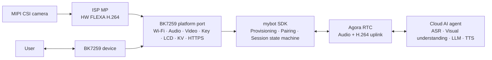

# mybot-bk7259

[](LICENSE)
[](https://github.com/junlon2006/mybot)
[](https://github.com/bekencorp/bk_avdk_smp)

**简体中文 | [English](README.md)**

**mybot-bk7259** 是开源 AI 多模态对话 SDK
[mybot](https://github.com/junlon2006/mybot) 面向 BK7259 AP/CP 平台的参考实现。
本仓库以 Git submodule 固定 BK 官方双核 SDK 和 AI 解决方案，将产品工程与 BK7259 平台适配
维护在父仓库，并在隔离构建副本中应用审核后的厂商补丁，用于复现构建、平台开发和社区协作。

> 本项目当前定位为 BK7259 参考实现，仍在持续开发中。用于量产产品前，请结合实际硬件
> 完成板级适配、安全审查、稳定性验证，并确认所有第三方组件的许可与商业使用条件。

## 与上游 mybot 的关系

[mybot](https://github.com/junlon2006/mybot) 是面向边缘设备的跨平台 AI 多模态对话 SDK。
其核心采用 C99 编写，依赖 AOSL 提供可移植运行时，并通过平台 `ops` 接口获取 Wi-Fi、
持久化存储、按键、显示、音频、视频和网络传输等设备能力。

本仓库不重新定义 mybot SDK，而是提供 BK7259 平台所需的完整实现：

- BK7259 AP/CP 双核启动、内存和 Flash 分区配置。
- Wi-Fi APSTA 配网（含强制门户）、网络重连和凭据持久化。
- 三路模拟输入采集、追加数字播放参考的本地 AEC、扬声器播放、音量控制和音频功耗管理。
- 可选的 MIPI 摄像头采集、ISP 图像处理、硬件 FLEXA H.264 编码和 RTC 视频上行。
- 单个 GPIO 按键短按切换对话、触摸屏确认恢复出厂，以及 MIPI 显示、EasyFlash KV、HTTPS 和设备 UID 适配。
- 基于 Agora RTSA 的全双工音频和可选 H.264 视频上行 AI 多模态会话。
- 内嵌中英文 OGG 资源，用于配网提示音和配对码播报。
- 包含 CP 与 AP 固件的完整烧录镜像和 OTA 包。

设备服务、Agora RTC 云服务和云端 AI Agent 不在本仓库范围内。要跑通完整流程，
需要一个兼容 mybot 协议的设备服务。

## 系统架构



BK7259 固件采用 AP/CP 双核架构：

- **CP** 负责基础系统初始化和 SMP 启动控制。
- **AP** 初始化媒体服务并运行产品控制循环，承载平台适配、设备生命周期、网络、音频、
  视频采集与编码、显示和 RTC 会话。
- **控制循环**（[ap_main.c](projects/mybot/ap/ap_main.c)）在联网前检查恢复出厂
  标记，再根据已保存的 Wi-Fi 凭据选择 APSTA 配网还是正常 STA 模式；网络就绪后启动
  mybot SDK，并处理会话切换、恢复出厂请求和生命周期日志。

## 仓库结构

| 路径 | 职责 | 来源 |
| --- | --- | --- |
| `bk_avdk_smp/` | BK7259 AP/CP SDK 与平台基础组件 | 官方 `bekencorp/bk_avdk_smp`，提交 `584b94792` |
| `bk_solution_ai/` | BK AI 解决方案组件 | 官方 `bekencorp/bk_solution_ai`，提交 `03aadb497` |
| `projects/mybot/` | AP/CP 入口、R2 板级配置、分区表和提示音资源 | 父仓库 |
| `components/mybot/` | mybot SDK、BK7259 平台适配、AOSL 和 RTSA | 父仓库 |
| `patches/`、`vendor.lock.json` | 审核后的厂商改动、固定版本和补丁摘要 | 父仓库 |
| `scripts/` | 依赖准备、源码校验和隔离双语构建 | 父仓库 |

`release/v4.0.1-mybot-r2` 分支适配耘趣 V1.0 R2 板。产品源码及必要的 DNS、GC9503CV LCD、
三路输入 AEC 和摄像头辅助补丁均在本仓库维护，不再依赖个人账号下的 BK fork。
两个官方子模块固定到 gitlink 对应提交并保持干净；构建时校验 `vendor.lock.json`，
在生成副本中应用补丁。此次迁移保留现有 R2 行为和算法库，不同时升级厂商 SDK。
完整版本、补丁来源和验证边界见 [BK 官方依赖管理](docs/OFFICIAL_DEPENDENCIES.md)。

`components/mybot` 是一个组件容器，包含三个目录：

- `mybot_sdk` —— 内嵌的 mybot SDK 源码和 BK7259 平台操作（编译为 `mybot_sdk` 组件）。
- `mybot_aosl` —— 内嵌的 AOSL 组件（`mybot_aosl`）。
- `mybot_rtsa` —— 内嵌的 Agora RTSA SDK（`include/` 头文件与
  `lib/arm/libagora-rtc-sdk.a`）。

产品内嵌的 mybot SDK 同步上游 `main` 最新已提交快照
`58f0ef9c14be9f159b1dc167bf0f035983b25117`（标签 `v1.3.0`，SDK 版本 1.3.0）。
本次同步更新发布版本及源码注释，平台接口、RTC 和媒体行为与上一快照一致。
通过 RTM P2P 与频道消息进行 MCP 控制时，仅接受单层 `message.user` 信封，`data_type` 为
`message`，字符串 `content` 内包含 DeviceCommand v1。支持 `audio.set_volume`
（`params.level` 为 0–100 的整数）和 `audio.adjust_volume`（`params.delta` 为 -100–100 的整数）。
正数增加音量，负数减少音量，0 保持不变，结果钳制到 0–100。裸命令、`audio.set_mute`
及情绪命令不再通过 RTM 执行。执行前核对当前发送者、频道、会话及会话代次。
`issued_at`/`expires_at` 可以省略或提供，均忽略，不检查时钟或有效期。
本会话最近 16 个不同的 `command_id` 按 FIFO 去重，重复不会刷新位置或重复增减音量，新 ID 替换最老记录，
已被淘汰的 ID 可能再次执行。原有声纹与服务端阶段处理保持不变，控制事件非阻塞投递、
重新配对时清理开聊请求、提示音代次跟踪及 HTTP/JSON 边界修复也保留。
同时包含视频控制串行化、提示音延后销毁、统一的 RTM 到 LCD 状态处理，以及 RTM
`listening/thinking/speaking` 服务端状态 LCD indicator 和可选视频上行契约；BK7259 构建默认开启
视频。该上游快照已经包含 `RTC_LOG_ERROR` 和恢复 AOSL 日志门限的修复；`SDK_REVISION` 另记录
打印 HTTPS 请求与响应 body 的 BK7259 目标 patch。
挂断会先停止本地视频与 RTC、清理会话 PCM 并恢复 READY，再排队发送一次 HTTP(S) 停止通知。
绑定状态轮询和停止通知由独立的 `service_mpq` 执行，慢响应不会阻塞控制操作或下一次开聊。
通知失败只记录日志、不重试；开聊、配对码和 token 续期仍同步执行，SDK 关闭时排空后台线程。
HTTPS 适配支持独立连接并按连接查询 socket 错误状态。
`SDK_REVISION` 同时记录
`include/`、`src/` 的确定性聚合摘要。AOSL 基线为 commit
`84e086084ebcd0ae2455a0ce5721950c5fe2e656`，另有五处已记录的 BK7259 HAL 修改。构建过程不接受
`MYBOT_SDK_DIR` 或外部 AOSL 源码路径。

SDK 移除 RTM 字符串的 512 字节预览限制和 RTC 错误的 64 字节固定存储，将完整内容交给日志层，
并在 RTC 错误字符串借用有效期间完成复制。BK7259 AOSL HAL 仍使用 8 KiB 的整行日志缓冲，
更长的日志行仍可能截断。常规 RTM 消息日志仍为 DEBUG，默认 NOTICE 等级不打印。

MCP 音量设置/增减复用已有 BK7259 音量适配，命令通路尚需真机验证。
BK7259 视图保留本地表情及声纹/服务端阶段 indicator 的 bit 0-3；当前 SDK 快照关闭云端
MCP 情绪入口。本地 LCD 表情不触发 EB521 UART/云台动作。手动 CLI 舵机控制需启用
`CONFIG_MYBOT_GIMBAL=y`，当前音频对比固件已关闭该开关。

## 环境要求

- 支持 Git submodule 的 Git。
- Linux 构建环境，以及 `bk_avdk_smp` 所需的交叉编译工具链。
- 耘趣 V1.0 / Robot R2 接线的 BK7259 开发板，使用 GC9503CV MIPI 屏；当前三路音频配置见下文。
- 可访问兼容的 mybot 设备服务和有效的 Agora 服务配置。

板级文档随子模块提供：解决方案与 AVDK 见 `bk_solution_ai/docs/bk7259/`，
SDK 与烧录工具见 `bk_avdk_smp`。

## 获取源码

通过 HTTPS 克隆本仓库及其子模块：

```bash
git clone --branch release/v4.0.1-mybot-r2 --recurse-submodules https://github.com/junlon2006/mybot-bk7259.git
cd mybot-bk7259
```

如果顶层仓库已经克隆但未拉取子模块，执行：

```bash
git submodule sync --recursive
git submodule update --init --recursive
```

克隆后可用以下命令查看被固定的版本：

```bash
git submodule status
```

GitHub 下载缓慢时，请保留 `.gitmodules` 中的规范 URL，仅把本地仓库作为命令级镜像：

```bash
git -c protocol.file.allow=always \
    -c 'url.file:///path/to/bk_avdk_smp.insteadOf=https://github.com/bekencorp/bk_avdk_smp.git' \
    -c 'url.file:///path/to/bk_solution_ai.insteadOf=https://github.com/bekencorp/bk_solution_ai.git' \
    submodule update --init
```

该做法不会持久化本地路径，也不会修改对外发布的子模块 URL。

## 构建固件

在仓库根目录使用统一构建入口。脚本校验官方版本和补丁摘要，在隔离副本中应用补丁，
再分别构建中英文 AP/CP：

```bash
python3 scripts/check_sources.py
python3 scripts/build_all.py
```

`scripts/build_all.py` 在独立工程副本中编译 AP/CP，保留源工程配置和官方子模块，
支持 `--language`、`--dry-run`、`--no-clean`、`--build-root` 和 `--output-root`。
执行 `python3 scripts/build_all.py` 编译中英文两个版本，也可用 `--language zh-CN`
或 `--language en-US` 单独选择。默认产物为 `releases/bk7259-zh-CN-video.bin` 和
`releases/bk7259-en-US-video.bin`；关闭 `CONFIG_MYBOT_VIDEO` 后文件名不包含 `-video` 后缀。
两种语言沿用所选的设备服务协议，脚本校验生成配置及 ELF 中的服务器地址。
HTTP 固件增加 `-http` 后缀，例如 `releases/bk7259-zh-CN-video-http.bin`；关闭视频时为
`bk7259-zh-CN-http.bin`。

目前仅支持 `MYBOT_AUDIO_PTIME_MS=60`，其他取值会被拒绝。需要直接使用厂商 `make` 时，
先准备所选语言的工程：

```bash
python3 scripts/prepare_vendor.py --language zh-CN
```

随后执行工具打印的完整 `make` 命令，其中已指定生成工程及匹配的 `SDK_DIR`。
不要将源工程直接指向未经补丁准备的官方 SDK。准备工具不会联网、重置或修改官方源码；
缓存和升级规则见 [依赖管理说明](docs/OFFICIAL_DEPENDENCIES.md)。

默认中文视频构建的产物输出到
`build/build-bk7259-zh-CN-video/solution/projects/mybot/build/bk7259/mybot/package/`：

| 文件 | 用途 |
| --- | --- |
| `all-app.bin` | 包含 bootloader、CP 与 AP 固件的完整烧录镜像 |
| `app_pack.rbl` | 包含 CP 与 AP 固件的 OTA 包 |
| `build_summary.txt` | Flash、SRAM、IRAM、DTCM 和 PSRAM 占用报告 |

CP 与 AP 的独立镜像分别位于：

- `<生成工程>/build/bk7259/mybot/bk7259/app.bin`
- `<生成工程>/build/bk7259/mybot/bk7259_ap/app.bin`

英文对应 `build/build-bk7259-en-US-video/`；可通过 `--build-root` 和 `--output-root`
使用独立的测试构建和固件输出目录。

## 烧录与运行

使用 Beken 烧录工具把 `all-app.bin` 写入设备，具体步骤参考目标开发板说明和随
`bk_avdk_smp` 提供的 Beken 烧录文档。

参考设备的运行流程为：

1. 首次上电或没有有效 Wi-Fi 凭据时，设备进入 APSTA 配网模式，创建开放的
   `mybot-xxxx` SoftAP。
2. 连接该 SoftAP 并打开 `http://192.168.4.1/`，选择目标网络并提交凭据。配置页面也会
   自动弹出，无需手动输入地址，详见 [Wi-Fi 配网](#wi-fi-配网)。
3. STA 链路获取到 IPv4 地址后，门户和 SoftAP 停止，设备启动 mybot SDK 完成注册、配对
   和鉴权。
4. 未绑定的设备会显示并播报配对码，在网页控制台输入该码；绑定完成后，短按松手发起
   全双工音频 AI 对话，再次短按松手结束对话；启用 `CONFIG_MYBOT_VIDEO=y` 后同时提供摄像头视频上行。
5. 只更换 Wi-Fi 时，选择“设置”→“配网”并确认。设备停止 SDK 后开启配网热点，成功后
   重新启动 SDK；取消时尝试恢复原保存网络。
6. 点击屏幕右上角“设置”→“恢复出厂”，二次确认后清理本地设置并重启，随后重新配网。
   点击“取消”仅关闭弹窗，不停止当前会话。

若存在有效的恢复出厂标记，设备先完成清理并重启，之后才走上述联网流程。

耘趣 V1.0 产品只有一个固件可见的 GPIO 对话按键：

| 按键 | GPIO | 有效电平 | 短按 | 长按 |
| --- | --- | --- | --- | --- |
| 对话键 | GPIO47（`KEY1`） | 低电平 | 松手时开始 / 结束对话 | 达到 5 秒仅忽略，松手不发事件 |

GPIO 分配以及显示、音频和摄像头外设连接属于板级配置。移植到不同的 BK7259 硬件需要做
相应的配置和平台改动。

## 配置

主要工程配置文件：

- AP：`projects/mybot/ap/config/bk7259_ap/defconfig`
- CP：`projects/mybot/cp/config/bk7259/defconfig`
- Flash 分区：`projects/mybot/partitions/bk7259/auto_partitions.csv`
- SRAM/PSRAM 布局：`projects/mybot/partitions/bk7259/ram_regions.csv`

`MyBot BK7259 platform` Kconfig 菜单提供：

- `CONFIG_MYBOT_LANGUAGE_ZH_CN`：中文服务区域、LCD 文案与提示音资源。
- `CONFIG_MYBOT_LANGUAGE_EN_US`：英文服务区域、LCD 文案与提示音资源。
- `CONFIG_MYBOT_HTTPS`：设备服务 REST 请求协议，默认开启 HTTPS。在 AP defconfig 中改为
  `# CONFIG_MYBOT_HTTPS is not set`，按上面的命令 clean 后重新编译即可切换为 HTTP；
  恢复 `CONFIG_MYBOT_HTTPS=y`，再次 clean 后重新编译即可切回 HTTPS。
- `CONFIG_MYBOT_LVGL_UI_ANIMATIONS`：像素表情切换过渡、表情动态效果与 500 ms 光标闪烁，默认启用；
  UI 固定采用工艺灰风格。
- `CONFIG_MYBOT_VIDEO`：编码视频上行，默认开启；改为
  `# CONFIG_MYBOT_VIDEO is not set` 并 clean 后重新编译即可关闭。
- `CONFIG_MYBOT_VIDEO_WIDTH` / `CONFIG_MYBOT_VIDEO_HEIGHT`：ISP 编码输出，参考值为
  `640x480`。
- `CONFIG_MYBOT_VIDEO_SENSOR_WIDTH` / `CONFIG_MYBOT_VIDEO_SENSOR_HEIGHT` /
  `CONFIG_MYBOT_VIDEO_SENSOR_FPS`：MIPI sensor 输入，参考值为 `1280x720@5fps`。
- `CONFIG_MYBOT_VIDEO_MIN_BPS` / `CONFIG_MYBOT_VIDEO_MAX_BPS`：H.264 码率范围，参考值为
  `256000` 到 `512000` bit/s。
- `CONFIG_MYBOT_KEY_GPIO`、`CONFIG_MYBOT_KEY_ACTIVE_LEVEL`：单个对话键的 GPIO 和有效电平。

语言选项同时决定 LCD 文案、服务区域和提示音资源目录；默认 HTTPS 配置下，中文地址为
`https://botstation.shengwang.cn/api`，英文地址为 `https://botstation.agora.io/api`。
两个语言选项必须且只能启用一个。
HTTP 模式仅将协议改为 `http://`，保留相同的域名与 `/api` 路径。协议开关同时映射为 SDK 的
`MYBOT_ENABLE_HTTPS` 及取反的 `MYBOT_ALLOW_INSECURE_HTTP` 编译定义；不改变 RTC/RTM
以及本地 HTTP 配网门户。

本次 R2 迁移保留原来的两张 PEM 根证书（ISRG Root X1、DigiCert Global Root G2），
不合入 `main` 的按地区单根证书优化。该证书集未覆盖需要 GoDaddy G2 的服务端证书链，
海外地址在部署前仍需单独核验证书链；证书和主机名校验保持开启。

设备身份不由配置决定：[ap_main.c](projects/mybot/ap/ap_main.c) 在运行时
读取由 CP 提供的芯片唯一 UID，使用 HMAC-SHA256 和 `mybot-bk7259-device-id-v1` 派生密钥，
取摘要前 12 字节并转换为大写十六进制，格式为 `BK7259-<24位大写十六进制>`。固件版本上报 SDK 自身的
`MYBOT_VERSION_STRING`，硬件型号固定为 `mybot-bk7259`，两者在启动时打印。UID 无法读取的
设备没有身份，会打印失败日志并拒绝启动。请勿把生产环境服务凭据提交到仓库。

## 按键

单个对话键使用 GPIO47（`KEY1`）低电平有效输入，每 20 ms 扫描，两次一致采样消抖。
不足 5 秒的按压在松手后发出会话切换请求；产品任务查询 `mybot_get_state()`：
`READY` 发出开始对话事件，`IN_CONVERSATION` 发出结束对话事件，其他 SDK 状态忽略短按。
按住达到 5 秒仅忽略，松手不再发出会话事件。恢复出厂改由触摸屏设置入口二次确认。
双击、音量和预留按键事件均未注册。

[usr_gpio_cfg.h](projects/mybot/ap/config/bk7259_ap/usr_gpio_cfg.h)
将 GPIO47（`KEY1`）配置为带内部上拉的输入。CEN 按键只保留硬件复位功能。

按键准备时若已按住，必须先松开再开始新手势。触摸屏跟随产品显示生命周期，配网、
网络断开、会话中及 SDK 启动失败后的等待状态均可使用，不依赖 SDK 按键回调。

## 恢复出厂

右上角“设置”在配网、配对、断网、SDK 失败和表情页面均可使用。只有单指在同一按钮内
按下并抬起才生效；拖动、多指、输入取消及打开弹窗的那次触摸不会激活下一层按钮。
确认或重试后立即禁用重复操作。恢复中和重启时不能取消，失败页直接提供“重试”。

CST7XX 使用 GPIO44 复位、GPIO43 中断、GPIO65 SDA/GPIO64 SCL；480×640 触点转换为
640×480 逻辑坐标。GPIO43 必须同时声明输出和输入能力，驱动复位时先将 INT 输出高电平，
然后切成中断输入；只声明输入会在 GPIO 初始化时失败。坐标映射为
`x=639-raw_y, y=raw_x`。触摸由产品显示所有者管理，在检查恢复标记和
启用摄像头前准备好，SDK 停止后仍可操作。触摸与摄像头共用带互斥和引用计数的软件 I²C。
对应驱动及有界退出支持通过 `0004` 厂商补丁引入。触摸不可用时显示提示并禁用恢复控件，
普通 SDK 启动和物理会话按键仍可工作。

屏幕右上角“设置”→“恢复出厂”打开二次确认；取消只关闭弹层并显示最新状态。
确认后禁用重复操作，产品任务处理恢复请求，触摸回调只投递标志，不直接操作 Flash、网络或 SDK：

1. 显示“正在恢复出厂设置”，保存并读回校验 `mybot.factory_reset.v1` 恢复意图。
2. 调用 `mybot_stop()`，确认 SDK 已停止且状态为 `STOPPED`。
3. 停止配网门户、SoftAP、扫描和 STA，并确认驱动停止成功。
4. 依次删除下表三个产品记录并检查其已不存在，最后删除恢复意图。
5. 显示“恢复完成，正在重启”，重启后进入无本地 Wi-Fi 凭据的配网流程。

| 删除的记录 | 内容 |
| --- | --- |
| `mybot.device_auth` | 本地设备鉴权数据 |
| `mybot.wifi.v1` | Wi-Fi 凭据 |
| `mybot.volume.v1` | 持久化音量 |

恢复出厂不擦除整个 EasyFlash ENV、固件或射频校准数据；芯片 UID 和派生设备 ID 保持
不变，也不调用服务端解绑接口。重新联网后 SDK 重新注册，并按服务端保留的绑定状态工作。

任一步失败都不会自动重启，屏幕提供“重试”按钮；业务保持停止，新一次点击才重试，
不能返回普通会话。未完成的清理保留意图，最终标记删除报错时尝试重建标记。
有效恢复意图持久化后若断电，下次启动会在联网和启动 SDK 前继续
清理。可检测的标记异常显示失败页，等待触屏重试；在产品任务写入意图之前断电不会保留
仅存于内存的确认请求。

接口独立放在
[`bk7259_factory_reset.h`](components/mybot/mybot_sdk/platforms/bk7259/include/bk7259_factory_reset.h)
和 [`bk7259_key.h`](components/mybot/mybot_sdk/platforms/bk7259/include/bk7259_key.h)，
新增接口使用 `bk7259_*` 命名。`mybot_bk7259_platform.h` 保持平台级抽象。

## 上电初始化

CP 启动 AP 后，AP 调用 `bk_init()`、打印版本并初始化媒体服务，再创建产品控制任务。
产品任务按以下顺序初始化：

1. 读取 UID 并生成设备 ID、服务地址和版本配置，初始化 AOSL。
2. 准备 LCD、Wi-Fi 管理器和 GPIO47 按键扫描。
3. 检查持久恢复意图；有效标记先续做恢复，可检测的异常标记等待新的长按。
4. 无恢复任务时注册平台描述符，再连接已存 Wi-Fi 或进入 APSTA 门户。
5. 获取 STA IPv4 并关闭门户、SoftAP 后调用 `mybot_start()`。
6. 产品循环处理短按、恢复请求和 SDK 状态日志；会话由 SDK 管理，启用视频时在 RTC 连接后启动采集和编码。

正常网络设置或 SDK 启动失败后，产品保留已准备好的显示和触摸输入，可再次配网或确认恢复出厂。
媒体、平台准备或描述符注册等更早的初始化错误会退出产品任务。

## 显示

产品层从平台准备到平台关闭全程独占一块 GC9503CV MIPI 屏，因此在 mybot SDK 停止期间
配网和恢复出厂界面依然可见。物理分辨率为 480x640，按 640x480 的逻辑 RGB565 画面渲染。
GPIO20 控制 3.3V 供电，GPIO29 控制 LCD/摄像头共用的 2.8V 电源，GPIO42 为复位，
GPIO40 背光低有效。GPIO27 在平台准备阶段输出高电平，使能摄像头外部 1.2V 电源。
显示的板级电源 owner 持有 2.8V 和 1.2V 电源直到完整平台关闭；结束会话或视频只通过
GPIO30 复位摄像头，保留板级电源，保持屏幕点亮。

LVGL 9.5.0 渲染器采用用户提供模拟器的 `process`（工艺灰）皮肤与 `geek`（像素眼镜）画法，
使用 `#050708` 固定黑色玻璃底与灰色装饰，避免 RGB565 深色渐变色带。实际进入 `READY` 时显示“中性待机”：
`#f1f1ee` 米白镜框、双弧眼和微笑。进入 `IN_CONVERSATION` 时先显示 SURPRISED，
进入过渡结束后保持 300 ms，再按最新服务端阶段选择表情：LISTENING 显示认真聆听，
THINKING 显示专注思考，连续超过 3 秒转 PROCESSING；SPEAKING 或无有效阶段显示 NEUTRAL。
挂断后回到中性待机。
Wi-Fi 配网成功后仍按 SDK 流程完成鉴权与配对，只有实际达到 `READY` 才进入待机页面。

正常待机和会话界面保留四行终端文字，READY 状态下为：

```text
> OIM / R2
> mood: neutral
> state: ready
> agora / realtime
```

`mood` 随当前表情显示小写名称，与真实 SDK 状态独立。第三行显示实际状态；会话中例如
`> state: listening | vp:pending`，阶段随 SDK 更新为 `listening`、`thinking` 或 `speaking`；
多个阶段 indicator 同时有效时按 `speaking` > `thinking` > `listening` 显示；
没有有效阶段时显示 `in_conversation`。`vp:ok` 表示本次会话已收到声纹成功通知，
`vp:pending` 表示尚未确认。仅真实状态和页面均为 `IN_CONVERSATION` 时显示会话阶段和声纹，
选择 SLEEP 图案不会将真实状态改为 `standby`。`</>` 签名和最后一行的光标保留。
声纹更新只改文字；阶段更新也决定后台自动表情。同阶段重复更新不重置动画或三秒思考计时，
也不取消显式表情覆盖，不弹独立状态提示。
启动、配网、网页控制台配对、错误和恢复出厂仍保留必要的
中英文引导。CST7XX 触摸用于设置和恢复控制；GPU 关闭，不显示摄像头预览，也不控制云台动作。

模拟器全部 23 个表情通过独立模块
[bk7259_expression.h](components/mybot/mybot_sdk/platforms/bk7259/include/bk7259_expression.h)
提供。`bk7259_lcd_set_expression()` 复制持久本地覆盖请求到显示所有者，
`bk7259_lcd_clear_expression()` 恢复最新自动表情。仅 `READY`/`IN_CONVERSATION`
表情页面接受覆盖，流程页面切换时清除覆盖；配网等操作引导与恢复出厂保持优先。
重复本地请求不重播。

当前 SDK 快照关闭云端 MCP 情绪入口。会话开场的 300 ms 另计进入时的 250 ms 过渡；
关闭 UI 动画时不增加这段过渡时间。表情不自动轮播，
不触发云台动作；手动 UART CLI 独立保留，仅在 `CONFIG_MYBOT_GIMBAL=y` 时可用，
当前音频对比固件关闭。完整列表和调用示例见
[工程说明](projects/mybot/README_CN.md#6-r2-音频与显示)。

模拟器的 1024x896 画布按 9/16 等比缩放为 576x504 虚拟区域，位于 640x480 逻辑屏幕的
`(32,-12)`，上下只裁去空白，表情和文字保持在屏幕圆角安全区内。眼镜总宽约 345 像素；
终端文字保留参考的 37 像素源坐标行距，`</>` 左对齐。镜框、眼睛和嘴巴由固定 LVGL 控件与采样曲线绘制，
心形、星形、椭圆、腮红和泪滴使用五块小型只读 A8 抗锯齿蒙版，合计 13631 字节 Flash，消除三角扇接缝。
蒙版由参考几何在本地生成，不使用完整表情图片，不增加 canvas 整帧缓冲或 UI 任务。
生成和复现方法见 [display/SOURCES.md](components/mybot/mybot_sdk/platforms/bk7259/display/SOURCES.md#geometry-masks)。
开启动画时，表情切换使用 250 ms 过渡并保留表情动态效果，光标每 500 ms
闪烁；重复状态更新保留动画时钟，自动表情变化时使用同样的过渡。

应用通过现有 100 ms 状态观测循环，经原生 `bk7259_lcd.h` 接口发布复制后的 SDK 状态快照；
会话阶段和声纹 indicator 仍由现有 SDK LCD 回调提供。SDK 为 `STOPPED` 时配网引导继续可见，
同步停止期间沿用 STOPPING 引导页，停止完成后立即发布观测到的 stopped 状态；
恢复出厂提示始终优先于状态更新；恢复页第三行固定为 `> state: factory_reset`，移除会话阶段和
VP 字段。这是产品流程文字，不是新增 SDK 状态。
SDK 的 render 调用将内容复制到一个保存最新状态的 mailbox，并唤醒 `mybot_ui` 任务。
只有该任务更新运行中的视图、执行 LVGL timer 和刷屏；来不及处理的中间状态可以合并为
最新状态。SDK 的 LCD init/destroy 只做产品自有显示的挂接与解挂，所以 SDK 停止后，UI
任务仍可显示 APSTA 配网页面。跨线程状态与显示完成状态使用 BK7259 的 AOSL 原子接口。

恢复出厂的恢复中、失败和重启中页面通过同一显示任务渲染，中英文同步；恢复状态优先于
SDK 页面，SDK 的停止、render 或 LCD 解挂不会覆盖恢复提示。该功能复用现有视图和缓冲，
没有新增 UI 任务。

LVGL 生成原生 RGB565 条带，BK7259 后端将变化区域旋转写入空闲整帧缓冲，并从上一帧保留
未变化像素，再通过 DSI bus、panel 和 DPU 接口提交。已提交的缓冲必须等 DPU 完成回调
归还所有权后才能复用。关闭时等待 UI 任务与显示回调退出；关闭失败时保留资源，供后续重试。

显示内存预算与音视频流水线分开：

| 分配项 | 大小 | 内存区域 |
| --- | --- | --- |
| 两块 480x640 RGB565 扫描缓冲 | 2 x 614400 = 1228800 字节 | 非缓存媒体 frame slab |
| 一块 640x16 RGB565 绘制条带 | 20480 字节 | HSRAM |
| UI 任务栈 | 8192 字节 | HSRAM |
| LVGL 临时绘制层 | 单层优选 16 KiB；总量上限 64 KiB | HSRAM |
| LVGL 对象、样式、绘制任务与 RTOS 控制对象 | 额外动态分配，峰值需目标机测量 | HSRAM / RTOS 堆 |

`projects/mybot/ap/lv_conf_custom.h` 选择 `LV_USE_OS=LV_OS_NONE`、单软件绘制单元、50 ms
刷新间隔，并用 HSRAM 分配 LVGL 内部对象。64 KiB 只限制绘制层，不是 UI 总内存上限。
构建结果、宿主测试和待上板检查项见
[UI_VALIDATION.md](projects/mybot/UI_VALIDATION.md)。
像素表情复用现有显示任务、绘制条带和两块扫描缓冲；旧四张 64x64 emoji 资源保留历史源码，
不再链接到固件。终端装饰使用只读 BK7259 Terminal 位图字库：15 像素 ASCII 与 16 像素 `</>`
子集，合计 4634 字节位图；它们由 DejaVu Sans Mono Bold 生成，替代 Unscii 16，按 LVGL 实际
字宽贴近参考的缩放文字比例，光标按实际字宽定位。操作引导使用 20 像素 MyBot UI Sans。
UI 字库现含 185 个字符，覆盖 ASCII、配对、配网及恢复出厂中文文案；任意中文 SSID 或聊天内容需要
扩充字库。新字库替代原先直接渲染的字形子集。资源来源与许可证记录在
[display/SOURCES.md](components/mybot/mybot_sdk/platforms/bk7259/display/SOURCES.md)。

## 音频采集与音量

当前 R2 音频以此前与 `mcp-resource/new` 配套 Solution/AVDK 对照的配置为基础调优 MIC 增益；本地参考目录
不是构建输入。启用三路差分
模拟 ADC（`ch_bitmap=0x7`、`chl_num=3`），ADC0/1/2各使用16 dB模拟及4 dB数字增益，
按三个MIC输入送入算法；DMIC关闭，`adc_cfg.aec_en=3`追加数字播放参考，形成四条lane：
MIC[0,1,2]、REF@3。通道内硬件参考设为NONE，不再把ADC2作为参考。

采集链为 `onboard_mic_stream_v2 -> aec_v3_algorithm_v2 -> raw_stream`。AEC 使用硬件
APPEND模式和默认AUTO参考，`adc_ch_num=3`、`dual_ch=2`，启用传统降噪，关闭VAD（`vad_enable=0`），
`ec_only_output=1`、`multi_output_use_ec_out=1`。采集块640字节/20 ms、两块缓冲，
SDK仍接收16 kHz单声道S16 PCM，不增加ASR输出端口或UI方向回调。

配套AVDK包含三麦解交织、trimic标记与SSL3支持，实际仍调用 `aec_proc`；Solution中
“临时禁用AEC”的注释已过时。必需 wrapper、配置/算法头文件、算法库和配套库校验清单
由 `patches/bk_avdk_smp/0003-r2-trimic-aec.patch` 维护，算法库保持原 R2 的 `20261014` 版本。
GPIO12按参考配置为输出下拉，供ADC比较器放电；GPIO34/35保留附件的
`SECOND_FUNC_DISABLE + GPIO_OUTPUT`声明，开机仍为HIGH-Z。当前对比固件在AP defconfig配置
`# CONFIG_MYBOT_GIMBAL is not set`，不启用舵机模块、对应UART2映射和CLI注册，
不增加运行期采集电平日志。当前三路输入版本仍待真机验证。
扬声器继续使用GPIO50高电平使能功放。

音量通过 SDK 的 `audio_volume` ops 控制扬声器数字增益，变更时同步持久化到
`mybot.volume.v1`；写入失败会在后续设置或销毁音量模块时重试。当前板没有音量加减按键。
恢复出厂删除该记录，重启后按扬声器默认
增益初始化音量。

## 视频上行

视频默认开启（`CONFIG_MYBOT_VIDEO=y`）。在 AP defconfig 中改为
`# CONFIG_MYBOT_VIDEO is not set` 并 clean 后重新编译即可关闭。
启用后的 H.264 链路仅上行：`1280x720` MIPI CSI sensor 以 `5` fps 运行，ISP MP
生成 `640x480` NV12 帧，硬件 FLEXA H.264 编码器通过 Agora RTSA 主视频流发送完整 access
unit。设备不接收或渲染远端视频，音频链路仍为全双工。

启动 mybot 时只初始化视频 context，摄像头和编码器保持关闭；RTC 报告会话已连接后才打开
摄像头并启动编码。结束对话时，在离开 RTC 前依次停止视频 worker、编码器和摄像头，
通过 GPIO30 保持传感器复位；LCD 板级电源 owner 持有的 GPIO29/2.8V 与 GPIO27/1.2V
继续开启。外部 1.2V 电源在摄像头探测之前使能，启动日志为
`camera 1.2V power enabled: gpio=27 level=1`。
完整 SDK 关闭流程也会再次执行 stop/destroy 作为兜底，板级电源保留到完整平台关闭。
RTSA 的带宽估计回调会更新编码器目标
码率，并钳制在 `256000` 到 `512000` bit/s，初始目标为 `384000` bit/s；RTSA 关键帧请求会
强制生成 IDR。

视频帧将 RTSA `frame_rate` 元数据设为 `0`，让 RTSA 使用真实发送时间戳，而不是引入第二个
名义帧率。Solution codec helper 当前使用 30 帧 GOP，因此在 5 fps 下周期性 IDR 间隔约为
6 秒；RTSA 关键帧请求可以提前生成 IDR。

## Wi-Fi 配网

Wi-Fi 由产品层独立于 mybot SDK 生命周期持有。启动时固件从 EasyFlash 读取一条带版本的
凭据记录：优先尝试已保存的网络；未配网设备或已保存网络拿不到 IPv4 地址时，进入
[烧录与运行](#烧录与运行) 中描述的 APSTA 门户流程。

SoftAP 通过 DHCP 只下发 `192.168.4.1` 作为解析器，并对所有 DNS 查询都回该地址，因此
手机加入网络后发起的连通性探测（`captive.apple.com`、`generate_204` 等）会落到门户上
而不是解析失败；门户对这些路径返回指向自身的重定向，这就是配置页面无需手动输入地址
即可弹出的原因。DNS 那一半是上面分支上的 `bk_avdk_smp` 修复，重定向在门户侧。普通 AP
不受影响，因为改写只在 SoftAP 自身的 DNS 服务启用时生效。

设置菜单提供独立“配网”。确认时提示会结束当前会话，由产品任务停止 SDK，确认达到
`STOPPED` 后才开启 APSTA；配网成功后直接重启 SDK，无需重启整机。屏幕显示热点名称和
`http://192.168.4.1`。设备凭据、设备 ID、服务端绑定和音量保持。

新网络获得 IPv4 并进入保存阶段前，保留旧 Wi-Fi 记录，允许“取消配网”。取消与保存通过
同一原子状态决定先后；保存开始后不再接受取消，新配置完成后恢复 SDK。取消会关闭门户、
停止候选连接与扫描，再只尝试原保存网络。无保存网络或恢复失败时显示可重新配网的失败页，
不会自动反复开启门户。

网络连接、扫描和门户 I/O 同时检查配网取消与恢复请求，恢复出厂始终优先。驱动停止失败时
保留资源所有权供后续重试；SDK或网络清理未确认完成时，不重新启动服务。

## 内嵌语音资源

提示音资源以 16 kHz 单声道 Opus-in-Ogg 文件存放在
`projects/mybot/assets/locales/`，每种语言一个子目录。它们被编译成只读
C 数组写入 AP 固件，无需 SD 卡，也不占用单独的 `assets_data` 分区。解码后的 PCM 缓冲
在运行时从 PSRAM 分配。

修改或新增 OGG 文件后，必须在构建前手动重新生成 C 数组：

```bash
python3 projects/mybot/scripts/generate_assets_c.py \
  projects/mybot/assets \
  components/mybot/mybot_sdk/platforms/bk7259/bk7259_assets.c
```

生成脚本只收集 `locales/**/*.ogg`。音频格式与更新流程见
[`projects/mybot/assets/README.md`](projects/mybot/assets/README.md)，
由 PCM 生成 Ogg 可参考 `scripts/convert_pcm_to_ogg.sh`。

## 源码边界

- 内嵌的 mybot SDK `include/`、`src/` 以上游完整快照为基线，并包含 `SDK_REVISION` 明示的
  BK7259 目标 patch；`platforms/` 是 BK7259 平台适配源码。
- 内嵌的 AOSL 锁定在记录的版本，包括已声明的五处 BK7259 HAL 修改。
- `bk_avdk_smp`、`bk_solution_ai` 为固定提交的官方干净子模块。双核强制门户 DNS、
  GC9503CV LCD、三路输入 AEC 及摄像头辅助适配由父仓库补丁维护，只在生成副本中应用。
  mybot 的音频、视频、配网和显示集成使用公开组件 API。
- BK 平台源码只通过 `<mybot/platform/...>` 引用 mybot。
- `projects/mybot/ap/ap_main.c` 是公开 `<mybot/mybot.h>` API 的唯一应用生命周期使用者，
  也是唯一包含公开头 `<mybot/mybot_version.h>` 的产品源码。
- RTSA 静态库按常规方式链接，绝不使用 `--whole-archive`。
- AVDK 的 `agora-iot-sdk` 组件保持关闭，其较旧的 RTSA 和 AOSL 不属于本固件。

## 子模块版本管理

普通使用者应保持顶层仓库固定的版本：

```bash
git pull --ff-only
git submodule sync --recursive
git submodule update --init --recursive
```

普通开发不要使用 `git submodule update --remote`；官方子模块处于 detached HEAD 是预期状态。
维护者升级时必须同时审核兼容的官方提交、gitlink、`vendor.lock.json` 与补丁集，
再完成中英文构建及 R2 板级回归。补丁应用失败会中止准备。
完整规则见 [BK 官方依赖管理](docs/OFFICIAL_DEPENDENCIES.md)。不要提交生成厂商副本、
固件、`build/`、`__pycache__/` 或本地参考资料。

## 当前开发限制

- 最小 APSTA 使用本地开放 SoftAP 和明文 HTTP。量产部署仍需确定持有性证明或等效的
  入网安全方案。
- EasyFlash 凭据存储可用，但静态加密仍需产品安全决策。
- 目标 RTSA 头文件区分 RTC 与 RTM token，在宣称端到端 RTM 前需确认设备服务 token
  在两者中都被接受。
- 最小描述符中已启用硬件音量和本地提示音。音量持久化在 EasyFlash，提示音资源以
  Ogg/Opus 内嵌在 `projects/mybot/assets/`；唤醒词仍关闭。
- 编码视频链路已配置为 5 fps，但持续出帧节奏、码率自适应、关键帧/GOP 行为和重复会话
  start/stop 仍需在目标摄像头硬件上完成运行时验证。
- R2 屏幕、结束会话后屏幕保持点亮、此前双模拟麦/ADC2参考的上行和 AEC、长按恢复出厂及像素眼镜基础渲染
  已由用户反馈真机测试通过；当前三路输入音频版本仍待烧录验证。四行文字与完整 23 表情尚待用户上板验证；中英文画面、表情过渡、
  断电续做、Flash/驱动故障、长时间运行及同时音视频的 HSRAM 和栈峰值仍需专项真机验证。
- 触屏恢复的GPIO43修正版已收到用户实机测试通过反馈；主机测试与固件构建通过。
  长时间音视频并发、断电续做和故障注入仍需专项实机验证。
- 单个 GPIO 按键采用耘趣 V1.0 的 KEY1/GPIO47 输入配置，CEN 保留硬件复位功能。

## 文档

- [BK7259 MyBot 工程说明](projects/mybot/README_CN.md)
- [BK 官方依赖与隔离构建](docs/OFFICIAL_DEPENDENCIES.md)
- [mybot 项目](https://github.com/junlon2006/mybot)
- [mybot 英文文档](https://github.com/junlon2006/mybot/blob/main/README.md)
- [mybot 移植指南](https://github.com/junlon2006/mybot/blob/main/docs/PORTING.md)
- [mybot 嵌入式集成指南](https://github.com/junlon2006/mybot/blob/main/docs/EMBEDDED.md)
- [BK7259 SDK 与解决方案文档](bk_solution_ai/docs/bk7259/)

## 贡献

欢迎提交 Issue 和 Pull Request：

- 与平台无关的 SDK 功能和公开 API 改动，请提交到
  [上游 mybot 项目](https://github.com/junlon2006/mybot)。
- BK7259 产品、平台与构建改动提交到本仓库；必要厂商改动维护到受版本锁约束的补丁集。
  通用厂商修复也可向官方 [BK Solution](https://github.com/bekencorp/bk_solution_ai) 或
  [BK AVDK](https://github.com/bekencorp/bk_avdk_smp) 提交。
- 集成、构建和文档问题请提交到
  [mybot-bk7259 Issues](https://github.com/junlon2006/mybot-bk7259/issues)。

请保持每个改动聚焦，说明所用硬件、配置和验证方式，不要提交构建产物。

## 许可证与第三方依赖

本顶层仓库的原创内容采用 [Apache License 2.0](LICENSE) 许可。

两个子模块及其第三方组件分别受各自许可证和使用条款约束，包括但不限于：

- [bk_avdk_smp 许可证](bk_avdk_smp/LICENSE)
- [bk_solution_ai 许可证](bk_solution_ai/LICENSE)
- [AOSL 许可证及附加条款](components/mybot/mybot_aosl/aosl/LICENSE)
- [提示音资源许可证](projects/mybot/assets/LICENSE.xiaozhi-esp32)
- [LVGL 许可证](bk_avdk_smp/ap/components/lvgl/LICENCE.txt)
- [LVGL 视图、字体和模拟器来源](components/mybot/mybot_sdk/platforms/bk7259/display/SOURCES.md)
- [BK7259 第三方声明](components/mybot/mybot_sdk/THIRD_PARTY_NOTICES.md)
- [mybot 第三方声明](https://github.com/junlon2006/mybot/blob/main/THIRD_PARTY_NOTICES.md)

AOSL 许可证在 Apache-2.0 之外还包含附加条款，因此本项目不得被描述为整体采用
Apache-2.0 许可。

Agora RTSA 二进制属于专有构建输入，上游 mybot SDK 不再分发。本仓库将其内嵌在
`components/mybot/mybot_rtsa`，为已验证的 BK7259 包 RTSA v1.10.1
构建 `1278380`，包名记录在其 `PACKAGE_INFO` 中，并由 `mybot_sdk/CMakeLists.txt` 固定
头文件与库的摘要：

```text
header   SHA256 29b1c21cbe416ee703eaa197ce623469619b1ed68cd3e9c66cb3abe2fafec7db
library  SHA256 40e8f93d9077eefe888e37b42ca0ddb5c7b2b6256b2f00cb7ba7c11c5551cb0f
```

Agora RTSA 等预编译二进制可能受试用期、再分发限制和商业许可约束。在用于产品或分发
固件之前，请自行确认并遵守所有适用条款。
