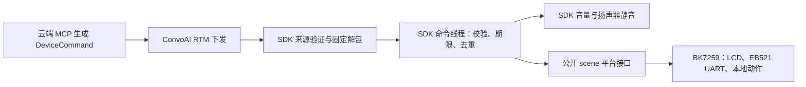

# agent-studio-device-firmware SDK DeviceCommand v1 接入方案

日期：2026-10-12。状态：历史设计稿，描述当时尚未实现的SDK功能。

2026-10-16时固件已使用实现DeviceCommand的SDK `e7793eba`。当前协议及接口以
`components/mybot/mybot_sdk/src/core/mybot_device_command.c`、
`components/mybot/mybot_sdk/include/mybot/platform/` 和
[工程说明](../projects/mybot/README_CN.md)为准。未采用下文建议的新clock/scene
平台注册接口；当前命令忽略issued_at/expires_at，不要求UTC时钟，舵机控制默认关闭。
下文保留原设计过程，不代表当前移植要求。

代码依据：固件锁定的 agent-studio-device-firmware 1.2.0、`cfd178a02fa94775cf01dc77e344f4ce5930225c`。
本方案还核对了该版本的 PORTING/EMBEDDED、平台描述符、音频、LCD 和 RTM 生命周期契约。

## 1. 目标与职责

SDK 提供平台无关的 **RTM DeviceCommand 接收、验证和执行协调**。云端 MCP 服务、
Streamable HTTP、API key、session context HMAC 和 LLM tool 调用仍由云端负责。
设备继续使用现有 RTC/RTM 会话及服务端分配的身份，不额外建立 MCP HTTP 连接。



一期实现三种 audio action 和四种 emotion scene。SDK 不解释舵机角度、UART 报文、图片或
23 个本地表情编号；场景平台实现负责这些映射。功能与视频开关独立。
设备 ACK、执行完成回传、云端业务重试、能力协商、远程脚本不进入本期协议。

## 2. 当前 SDK 的缺口

| 当前代码 | 已具备 | 本期需要补充 |
| --- | --- | --- |
| `src/rtc/mybot_agora_rtc.c` | RTM 登录、订阅、P2P/频道消息、回调复制和代次过滤 | 设备控制的可信来源检查、受限接收入口，避免消息洪峰占用音频队列 |
| `src/core/mybot_app.c` | P2P 仅记录；频道识别声纹和 listening/thinking/speaking | DeviceCommand 分流、不可变会话快照、开始/停止门控 |
| `src/media/mybot_audio.c` | 硬件音量优先、软件增益兜底 | 统一绝对/相对音量操作与独立 mute 状态、真实失败返回 |
| `src/media/mybot_media_pipeline.c` | 播放、短写、提示音及 AEC reference | 每次设备写入前的静音门控，覆盖已准备但尚未写完的 PCM |
| `include/mybot/platform/*` | 单一平台描述符，无 scene/UTC 接口 | 两组类型明确的平台接口与保持旧 ABI 的扩展注册 |
| BK7259 AOSL time HAL | 返回上电计时 | 由独立平台 UTC 接口提供可信 epoch；原有计时接口保持现状 |

另有两个实现细节必须处理：当前 JSON 的整数读取函数会把小数截断，object 查找函数
大小写不敏感；新协议不能直接沿用这些宽松行为。当前 BK7259 音量成功变更会立即写 KV，
用 `set_volume(0)` 实现临时静音会覆盖持久音量。

## 3. 版本与注册方式

建议发布 **SDK 1.3.0**，保留既有公开结构和函数 ABI：

- 不改变 `mybot_config_t`、`mybot_platform_descriptor_t`、`mybot_audio_volume_ops_t` 的布局。
- 原 `mybot_platform_register()` 保持原参数、原尺寸读取和原行为。
- 增加 `mybot_platform_register_ex()`，在同一份内部 registry 中一次性注册 base 和扩展。
- 两个入口共享“只允许一次成功注册”的约束，任一校验失败都不留下半注册状态。
- 不增加独立的 register_scene/register_clock，也不公开 SDK 私有 RTM 或会话结构。

现有描述符没有 size/version 字段，新库若直接追加字段并复制新尺寸，会越界读取旧调用方
的对象。因此不能把直接追加字段称为兼容 1.2 的 minor release。使用扩展入口保留旧 ABI；
若以后替换原描述符，则应按 major release 处理。

新头文件 `include/mybot/platform/mybot_platform_ex.h` 的接口草案：

```c
#define MYBOT_PLATFORM_EX_VERSION 1u

typedef struct {
    size_t struct_size;
    uint32_t api_version;
    const mybot_platform_descriptor_t *base;
    const mybot_scene_ops_t *scene;   /* optional */
    const mybot_clock_ops_t *clock;
} mybot_platform_descriptor_ex_t;

MYBOT_API int mybot_platform_register_ex(
    const mybot_platform_descriptor_ex_t *descriptor);
```

`struct_size/api_version` 在访问扩展字段前校验；v1 只读取已定义字段，不把整个调用方对象
按任意尺寸 memcpy。base 描述符在注册调用期间借用并复制；ops 表及其引用数据具有进程
生命周期。扩展版本与 DeviceCommand 的 wire version 是两个独立概念。

新增编译选项 `MYBOT_ENABLE_DEVICE_COMMANDS`，默认 OFF：

- OFF：保持现有运行流程，不创建命令线程、接收池或去重缓存。
- ON：要求扩展描述符提供合法 clock hook；缺少 hook 是启动配置错误。
- clock hook 已注册但尚未校时时：正常对话可以启动，远端设备控制暂时拒绝。
- scene ops 为 NULL：audio action 仍可执行，scene 记录 UNSUPPORTED。

## 4. 场景平台契约

新增 `include/mybot/platform/mybot_scene.h`：

```c
typedef enum {
    MYBOT_SCENE_HAPPY = 0,
    MYBOT_SCENE_SAD,
    MYBOT_SCENE_ANGRY,
    MYBOT_SCENE_SURPRISED,
    MYBOT_SCENE_COUNT
} mybot_scene_id_t;

enum {
    MYBOT_SCENE_HAS_INTENSITY = 1u << 0,
    MYBOT_SCENE_HAS_DURATION  = 1u << 1
};

typedef struct {
    mybot_scene_id_t scene;
    uint32_t parameters;
    float intensity;
    uint32_t duration_ms;
} mybot_scene_request_t;

typedef struct {
    int (*init)(void **ctx);
    int (*start)(void *ctx, const mybot_scene_request_t *request);
    int (*cancel)(void *ctx);
    int (*destroy)(void *ctx);
} mybot_scene_ops_t;
```

契约如下：

1. 参数缺省通过 HAS 标志表达。`intensity=0` 是合法显式参数，不等于“未提供”；默认值
   由平台的本地 scene registry 决定，SDK 不指定 BK7259 的动画时长或动作幅度。
2. request 仅在 start 调用期间借用。异步平台实现复制值，不保留该指针。
3. start 返回 0 表示接受请求，不表示舵机已完成动作；它只提交本地任务，不等待 duration。
4. 一期同时最多一个当前场景。SDK 在替换前 cancel，cancel 成功后才 start 新场景。
   本地 owner 使用自己的 generation 过滤旧动作和旧结束 timer。
5. cancel 返回 0 表示旧软件任务、待提交动作和 timer 已停止，之后不再提交旧场景效果。
   已经被硬件接受的 PCM、UART 字节或舵机目标不能被 SDK 撤回；平台负责协议允许的安全
   停止/收尾，不能把软件取消成功等同于物理瞬间停止。
6. cancel/destroy 的失败保留 ctx 和所有仍可能被异步工作引用的资源，禁止提前释放。
   新场景在取消失败时拒绝。后续 stop 可以重试清理。
7. SDK 串行调用 ops，平台回调不能同步调用 SDK 启停或 RTC；也不能直接从该回调操作
   非自己线程所有的 LVGL。LCD/UART 继续由平台 owner 执行。
8. duration 到期恢复该流程的默认表现。在 BK7259，会话内恢复 GREETING，READY 恢复
   NEUTRAL；配网、配对、恢复出厂提示优先。该规则属于平台实现。

没有 scene 完成回调或 ACK API；异步硬件失败在平台正式日志中记录。后续需要执行结果
协议时另做版本化扩展。

## 5. UTC 平台契约

新增 `include/mybot/platform/mybot_clock.h`：

```c
typedef struct {
    /* 0: synchronized, valid UTC epoch milliseconds.
       <0: unavailable or not trusted; output is not consumed. */
    int (*get_utc_ms)(int64_t *out_unix_ms);
} mybot_clock_ops_t;
```

该 hook 只读取已有时间快照，不能在调用中发起 NTP/HTTP、等待联网或执行长 I/O。
产品负责校时及有效性，SDK 负责时间字段解析、过期判断和排队期限。
BK7259 的 64 位 UTC 快照在锁内读写；原子操作使用 AOSL，不使用 GCC 原子内建。

不把 BK7259 的 `aosl_time_ms()` 当 UTC，也不为本功能修改它的 HAL 含义。新增模块的相对
期限使用 `aosl_tick_ms()`；当前 BK 计数源可能发生 32 位回绕，需要按有界时间跨度进行
差值计算，并覆盖回绕测试。

## 6. RTM 接收和来源验证

设备服务 start 响应已经有 conversation_id、local_uid、agent_uid 和 channel。
SDK 把它们复制成命令模块专用的不可变会话快照，不让命令线程直接读取控制线程正在
修改的字符串。

接收流程：

1. RTSA 普通回调取得同一次受锁快照中的 gate、generation、sender/route 条件。
2. 精确比较 actual publisher 与当前 agent_uid。频道消息比较当前 channel；P2P 核对当前
   本地 RTM 接收会话及登录代次。授权不使用 JSON 自报身份或 FNV 指纹。
3. 检查长度和已确认的消息类型，复制到固定接收池；回调不解析 JSON、不执行平台 I/O。
4. 非阻塞通知命令线程。池满或通知失败时拒绝/回收本次输入，不无限排队。
5. 命令线程解包、解析，执行前再次核对 gate、generation、conversation_id 和期限。

启用新功能时，为当前可信 Agent 的受支持 RTM 文本提供一个内部快速投递入口，避免先在
热 `rtc_mpq` 中解析完整业务消息。该入口只做受限复制。当前 SDK 的 callback gate 和 RTC
队列 barrier 不等于 fast-ingress 在途屏障；绕过队列后必须增加在途计数/完成屏障，关闭
入口并确认最后一个回调退出后才能释放 pool/ctx。RTC/RTM 登录、订阅、状态事件和音频
继续由原 rtc_mpq 管理。
声纹与 listening/thinking/speaking 的文本分类可在命令线程复用原 parser，再投递现有
control/presenter 路径；保持原协议和 indicator 语义。OFF 构建保留旧接收路径。

**外层协议是实施前联调项。** 本方案没有确定 `_publish_message` 的完整 RTM 外层。
应先保存真实 P2P/频道样本及其 type、custom_type、publisher、route，再实现一个固定
decoder。不能递归搜索任意 JSON 的 command 字段，也不能假定 MCP structuredContent
对象必然就是 RTM 原文。初始只支持经样本验证的格式；如果真实消息是二进制封装，应为
该具体格式增加受限 decoder，不按“像 UTF-8”猜测。

## 7. DeviceCommand v1 校验

内部 codec 输出固定 typed command，不把 JSON 对象或借用字符串传给平台。

| 内容 | 校验 |
| --- | --- |
| 根对象 | 必须为 object；type/schema/version/message_id/command_id/conversation_id/issued_at/expires_at/command 均完整 |
| 协议 | type 精确为 device_command；schema 精确为 botstation.device-command；version 为整数 1 |
| ID | 非空、不截断；按已确认长度上限校验；不强制 msg_/cmd_ 前缀；不接受 NUL/控制字符 |
| 会话 | conversation_id 与已验证服务响应完全相同；根对象不接受 device_id/mode |
| command | type 仅 action/scene；name 是固定枚举；params 必须为 object |
| JSON | 完整消费输入；拒绝重复解码键、非法 UTF-8/NUL、尾随 JSON 和超出预算的结构 |
| 字段 | 精确大小写；v1 根对象、command 和 params 拒绝未声明字段 |

数值校验使用有限的原始数值，检查整数性和范围后再转整型，不能用会截断小数的
`mybot_json_get_integer()` 单独判定。精确字段遍历不能采用当前大小写不敏感查找。

| type | name | params |
| --- | --- | --- |
| action | audio.set_volume | level：整数 0..100 |
| action | audio.adjust_volume | delta：整数 -100..100；应用后 clamp 到 0..100 |
| action | audio.set_mute | muted：严格布尔值 |
| scene | emotion.happy/sad/angry/surprised | 可选 intensity：有限数字 0..1；可选 duration_ms：整数 1..600000 |

内部语义记录保留解析后的 double intensity，到公开平台接口才转换为 float，避免两个
不同参数因 float 精度缩窄而被错误地判断为相同命令。

JSON 分配、深度和节点预算在解析时限制，不能先不受限生成整棵树再检查。可给现有私有
parser 增加一个 bounded 入口，保留旧 parse API 的行为。ISO 时间解析验证日历和溢出；
建议支持 UTC Z 与 0–3 位小数秒，服务端使用 Date.toISOString 格式。其他时间 profile
应在联调契约中确定后扩展。

未知 schema/version 或非控制消息记录计数并安全忽略。控制消息的参数错误不改变音量、
LCD、RTC 状态，也不结束正常对话。

## 8. 时间与去重

接收和执行两个阶段都校验时间：

- UTC 未可信：拒绝远端控制，理由 CLOCK_NOT_READY；本地音量键和正常对话继续运行。
- 验证 issued_at/expires_at 的顺序、TTL 上限和允许的有限时钟偏差。
- `now >= expires_at` 拒绝，无过期宽限；不能从收到消息的时刻重新给它 10 秒寿命。
- 接收槽保存回调接收的 monotonic 时刻。首次解析在快速读取当前 UTC 时同步采样
  monotonic，以 `sample_mono + (expires_at - sample_utc)` 建立 deadline，并以上次接收
  时刻加最大 TTL、future 容差及不确定性余量限制该 deadline。当前 UTC 已包含接收至
  解析的等待，不能再给予一个完整 TTL，也不能把同一等待重复扣除。
- 执行前同时检查 UTC 和已保存的 monotonic deadline。后续 UTC 回拨不能延长已经受理的
  指令；接收、复制到解析之前的等待和解析后的排队都算入有效期。
- 场景 duration 从平台实际开始执行计时，使用单调计时。传输 expires_at 到达并不结束
  已经开始的场景。显著校时跳变/失步时 clock provider 暂时返回无效，重新确认同步再恢复。

这里建议作为固件保护增加**当前会话内的有界去重**：

| 输入 | 处理 |
| --- | --- |
| 相同 command_id、相同正规化语义，message_id 相同或不同 | 重复，不再次加音量或重启动作 |
| 相同 command_id，但类型/参数/issued_at/expires_at 不同 | 冲突，拒绝替换 |
| 相同已登记 message_id，关联 command_id 或语义不同 | 冲突，拒绝 |
| 新 command_id/message_id，即使参数相同 | 新工具调用，正常执行 |
| 已受理动作失败或部分完成 | 记录失败，不自动重试 |

语义比较包含当前会话、类型、name、参数及时间，保留可选参数的 presence；不比较 JSON
空白和字段顺序。command 记录与 message 关联记录分别有界，先预留两者的容量再受理。
pending 状态也参与去重，防止动作尚未执行时重复入队。新 message_id 的重复投递只登记
关联；关联表满则拒绝该新投递，不覆盖旧记录。

仍可能有效的记录不得提前淘汰。缓存满时在副作用前拒绝新命令，不通过丢掉老记录来
接纳新的 delta。保留期限至少为首次可信接收单调时刻加最大 TTL、future issued 容差和
必要的时钟不确定性余量，不能仅保留 60 秒却允许提前 2 秒收到 60 秒 TTL 指令。
message 关联记录不早于其 command 记录淘汰，时钟回拨不提前清除。
去重只覆盖本次运行会话内已登记的消息，不承诺跨重启 exactly-once 或云端执行成功率。

## 9. 线程、资源和背压

建议增加一个 `command_mpq`，因为当前 control_mpq 会同步执行 HTTPS，可能占用数秒；
音量/场景不应跟随这些 HTTP 请求排队，也不能占用负责音频的 rtc_mpq。

| owner | 本期职责 |
| --- | --- |
| control_mpq | 会话生命周期，安装/撤销命令会话快照，必要的 command barrier；保持现有 HTTP 路径 |
| command_mpq | 有界输入、协议解析、期限、去重、音量/静音和 scene ops 调用 |
| pb_mpq | 每次输出前读取 mute gate，实际 PCM 写入和 AEC reference |
| 平台 scene owner | LCD/UART 的动作序列、缺省参数、duration timer、替换与取消 |

启用功能后，本地音量键也投递同一 command owner 的 typed 本地事件，避免两线程并行
read-modify-write。其入口不依赖 HTTP 控制 tick；会话开始/停止等按键仍走原控制流程。
未启用功能时保持现有按键音量路径。

增量音量按受理顺序执行，不合并 delta。场景可以替换当前场景，但不能把整个 command
接收机制做成只保存“最新一条”，否则音频动作会丢失。stop/cancel 用独立 gate 和 barrier，
不能因为接收 FIFO 满而失效。drain 每次只处理固定批量并在槽之间检查 stop mailbox；
本地音量事件持续进入也不能饿死取消。

允许 control → command 的有界同步 barrier；禁止 command → control/rtc 的同步调用。
当前 AOSL 的 `aosl_mpq_call()` 和 `aosl_mpq_destroy_wait()` 没有超时参数，不能把它们
直接当作有限 barrier。使用 NONBLOCK 投递、长期有效且带 generation 的完成对象及
`aosl_event_timedwait()`；唤醒后检查 generation/status，并按剩余 monotonic deadline 等待。
超时不代表回调已取消，不能传栈上结果指针或释放仍被回调引用的 event/context。
barrier 通知须独立于数据 FIFO 预留容量。最终销毁只有在队列静默、在途回调和平台操作
结束均已证明后进行；无法证明时保留 MPQ 与依赖资源，允许后续 stop 重试。
不持会话快照锁做平台 I/O。场景 start 只快速提交，cancel/音量操作也必须有界。
如果平台操作超时，关闭相关执行入口、保留仍在途的资源，不能释放正在被使用的对象。

建议的初始预算（均为 SDK 接收策略，**不是已确定的 wire 上限**）：

| 项目 | 初值 |
| --- | ---: |
| 受支持的原始控制消息 | 2 KiB，含外层；按真实样本确认 |
| message_id / command_id | 各最多 127 解码字节 |
| conversation_id / UID / channel | 与现有服务响应容量一致：127 / 63 / 127 字节 |
| JSON 深度 / 节点 | 8 / 64 |
| 接收池 | 8 槽；最多一个 drain 通知待执行 |
| command 记录 / message 关联记录 | 各 64 项 |
| command worker 栈 | 初始 8 KiB，须用最坏路径高水位校准 |
| 接收允许的最大 TTL / future issued 容差 | 60 秒 / 2 秒，需服务端确认 |

按 32 位目标估算，接收池约 18–19 KiB，两类缓存约 20–24 KiB，worker 栈 8 KiB，
解析暂存与 AOSL 通知还需约数 KiB；额外运行期预算约 50–60 KiB。最终以 struct 尺寸、
分配器、JSON 节点和目标峰值实测为准，不把这个估算当硬件上限。平台场景资源另计。
接收池和缓存启动时分配，回调不按输入速率申请无界 payload；协议解析临时分配受节点
及字节预算约束。所有原子状态走 AOSL，BK7259 不引入 GCC __atomic/__sync。

## 10. 音量与扬声器静音

SDK 增加独立的 `logical_level` 与 AOSL `playback_muted` gate：

| 操作 | 行为 |
| --- | --- |
| set_volume(level) | 真实音量 ops 或软件兜底成功后更新逻辑值；失败保留旧值 |
| adjust_volume(delta) | 从同一 owner 的逻辑值计算并限幅，再执行一次 set |
| set_mute(true) | 输出 PCM 置零，保留 logical_level；不调用硬件 set_volume(0) |
| muted 时 set/adjust | 更新所选音量，PCM 仍静音；解除后使用新音量 |
| set_mute(false) | 解除 PCM gate；不重放静音期间的积压声音 |

逻辑值在初始化时复用现有硬件 getter/SDK 记录或软件默认值；外部若能直接改硬件音量，
必须通过同一 owner 同步，不能在 SDK 之外偷偷修改并留下两份状态。
改造当前 void adjust helper，使其返回真实结果，不能忽略 set_volume 失败后记录执行成功。

一期采用 SDK PCM 静音，不扩展旧 audio ops 的布局：

- 每次设备 write 前读取 gate，无论是否启用了硬件音量。
- 覆盖旧的 `pb_pending` 短写剩余部分。播放 owner 在 mute 后继续消费输入并输出零，
  丢弃/清零静音期尚未播放的内容，解除后不恢复旧的非零 pending 数据。
- 不对同一短写缓冲重复乘软件增益；必要时用已有待播放区或预分配的写入暂存区。
- 已获准执行或已经进入设备缓冲的 PCM 可能继续播放有限时间；数字静音不承诺硬件
  瞬间无声。如果未来要求立即关闭功放/排空驱动，另增加有版本的硬件 mute 扩展。
- 麦克风、RTC 上行和视频保持原行为；软件 AEC reference 取实际被 write 接受的静音 PCM，
  不是静音前的数据。BK7259 ADC2 物理回采随实际扬声器输出变化。

建议 mute 为会话临时状态：旧会话输出撤销且 PCM 排空后解除，重启也解除。若 flush 失败，
保持输出门控到安全清理完成，不提前恢复声音。
数字 volume 为设备设置，维持原持久化策略；显式 set_volume(0) 仍可保存零音量。
临时 mute 不产生零音量的持久化写入。BK7259 适配时建议把逻辑音量持久化改为 debounce/
coalesce，在关闭时冲刷，避免连续远端调节反复写 Flash；这个节流属于平台存储策略。

## 11. 开始、停止与失败清理

开始会话：

1. 服务响应已有 conversation_id/channel/agent_uid，先复制成命令模块快照并推进 generation。
2. control owner 安装快照，确认 scene/audio 服务就绪，然后打开接收 gate。
3. 再执行现有 RTM 登录、频道订阅、RTC join。当前 SDK 的 IN_CONVERSATION 包括 RTC
   建立阶段，收到的有效控制可执行，不额外要求视频已启动。
4. 若任何启动步骤失败，立即撤销 gate/generation，清理接收数据及场景，再结束会话。

停止会话、断网、重新配对、恢复出厂和 SDK stop：

1. 在已确认的停止/断网入口立即撤销 gate 并推进 generation，不等待 HTTP 或普通 FIFO。
2. command barrier 使旧输入失效，取消平台场景/本地 timer；此时保留当前 mute，避免
   解除后突然播放旧的 pending 语音。
3. 按原顺序停止视频、离开 RTC/RTM、撤销旧播放授权并排空会话 PCM。确认旧音频不能
   再输出后才解除临时 mute，并恢复 SDK/默认 LCD 状态。
4. 最后才发送现有 HTTPS 停止通知，保留当前“本地停完再通知服务器”的行为。

完整 SDK 关闭时，command owner 必须在媒体、audio volume、KV、LCD 和 AOSL 引用释放前
静默并退出；部分启动失败的反向清理也遵守同一顺序。
取消/线程 join 失败时保留资源并允许后续 stop 重试；不得把未完成的清理报告为已经释放。
普通挂断若场景取消失败，先关闭设备控制入口、保留 scene ctx 并禁止新场景，RTC 仍可
按原流程离开；在取消完成前不开放下一次设备控制会话。

短暂 RTM 重连若仍属于同一 conversation，不清空去重；登录失败/订阅失败等当前 SDK 会
结束会话的事件继续按原语义处理。旧会话 timer、晚到消息与旧 async callback 不能影响新会话。

## 12. 文件与集成清单

在权威 agent-studio-device-firmware SDK 仓库实现，建议新增：

```text
include/mybot/platform/mybot_scene.h
include/mybot/platform/mybot_clock.h
include/mybot/platform/mybot_platform_ex.h
src/support/mybot_device_command_codec.c
src/internal/mybot_device_command_codec.h
src/core/mybot_device_command.c
src/internal/mybot_device_command.h
src/platform/mybot_scene.c
src/internal/mybot_scene_internal.h
```

| 修改点 | 内容 |
| --- | --- |
| `mybot_platform.c` / registry | 保留旧注册，扩展事务注册与校验 |
| `mybot_app.c` | 新模块 init/stop，会话快照，音量键路由与控制 barrier |
| `mybot_agora_rtc.c` / internal callback types | 有界快速文本投递，保留 legacy/RTC/audio 行为 |
| `mybot_audio.c` / internal header | 单一逻辑音量与 AOSL mute 状态，返回结果 |
| `mybot_media_pipeline.c` / internal header | pending/write 静音和正确 AEC reference |
| `mybot_json.c` / private header | bounded parse 入口，保持旧 parser API 行为 |
| CMake/build-config/install/export | 新源、可选特性、1.3.0 与新平台公共头 |
| Linux 平台与示例 | UTC hook、可测试的 scene 日志实现、扩展注册示例 |
| 文档/发布 | 中英文 PORTING、EMBEDDED、README、CHANGELOG、RELEASING |

BK7259 后续只增加平台适配：可信 UTC 快照、本地 scene registry、EB521 UART driver，
使用既有 `bk7259_lcd_set_expression/clear_expression`。原 `mybot_bk7259_platform.h` 不放
协议、场景或恢复出厂等具体模块接口；新的 BK 模块独立头文件并使用 `bk7259_*` 命名。

四种云端 scene 与本地 23 表情分别维护：HAPPY/SAD/SURPRISED 可直接对应；ANGRY 的本地
表现需明确选 ANNOYED 或补图案，不能直接去掉 emotion. 前缀后用字符串查找。
23 表情不自动成为云端合法枚举，扩展云端 scene 需要单独修改其工具/schema 契约。

SDK 上游实现完成并验证后，固件一次性同步该提交的完整 include/src，更新 SDK_REVISION、
版本、摘要、第三方记录和 BK component 的显式源列表及功能宏。不能只在当前 vendored
SDK 私有文件零散接线。同步前确认现有 HTTPS 日志 patch 与用户两处 RTM NOTICE 修改的
处理；保留的 patch 必须明确记录，不能把含本地差异的树称为纯上游快照。

## 13. 验证与验收

| 层次 | 必须覆盖 |
| --- | --- |
| codec UT | 七种 command name、合法边界、可选参数缺省/显式零、小数整数、类型、大小写、重复 key、UTF-8/NUL、日期、深度/节点/字节/OOM |
| manager UT | P2P/频道来源、错误 agent/channel/conversation/generation、先到消息、队列后过期、时钟未同步/跳变/tick 回绕 |
| 去重 UT | 同 ID 同语义、多 message_id、ID 冲突、新 ID 相同参数、pending 重复、平台失败、两张表满时不丢仍有效记录 |
| audio/media UT | hardware volume 和 software fallback、成功/失败、按键与远端 delta 同序、mute 时调音量、pending 短写、提示音、实际 AEC reference |
| scene UT | 借用值复制、快速替换、旧 timer、未注册/失败/部分效果、cancel 超时保留、destroy 与在途工作 |
| app/lifecycle UT | 快速启停、开始失败、挂断先于 HTTP、断网、重新配对/恢复出厂、非零 scene 清理结果、SDK stop 重试 |
| ABI/consumer | 老 descriptor/ops 不变；实际用 1.2 头文件预编译的 C/C++ consumer 对象与新 SDK 链接，旧注册不会读越界；扩展 size/version/必需回调校验 |
| 配置回归 | 功能 OFF/ON、video OFF/ON、cloud AEC OFF/ON、中英文及既有声纹/状态协议 |
| 目标联调 | 真实 ConvoAI → RTM 样本、音量/静音、四 scene、EB521、本地日志、持续音视频与 HTTP 同时运行的时延/堆/栈 |

正式日志记录命令名、受限 ID、受理/拒绝原因、执行结果、场景替换/取消。
重复、过期、未知版本、缓存满等日志/计数应有限，不逐帧打印原始 JSON 或凭证。
local ACCEPTED 不等于硬件 COMPLETED；一期不能用 MCP 工具成功推断设备执行成功。

## 14. 实施顺序与待确认契约

建议按以下顺序合入可独立验证的 SDK 改动：

1. 确认真实 RTM 样本和 wire profile；完成纯 codec 与 bounded JSON/date 测试。
2. 增加 scene/clock 公共头和 ABI 兼容扩展注册；通过旧/新 C/C++ consumer 测试。
3. 完成单一音量 owner、真实失败返回与 PCM mute；先验证短写/AEC/持久化语义。
4. 接入有界 command manager、来源与会话 gate、去重、开始/停止 barrier；测 HTTP 共存。
5. Linux 全部回归、发布 1.3.0；同步固件快照，再实现 BK7259 clock/LCD scene 和 EB521。

实施前还需与服务端确认：实际外层和 RTM 路由/消息类型，opaque ID 与消息尺寸、UTC 时间
profile、最大 command TTL、发送频率与接收预算。文档中的 10 秒是默认建议 TTL，不是
设备缓存、消息尺寸、2 秒容差或 60 秒上限已完成协商的证明。

没有真实下发样本也可以完成 codec/线程/平台接口的单元实现；只有真实 ConvoAI E2E 才能
宣布云端到设备的链路接入通过。该设计文档本身不代表实现、编译或硬件验收已经完成。
